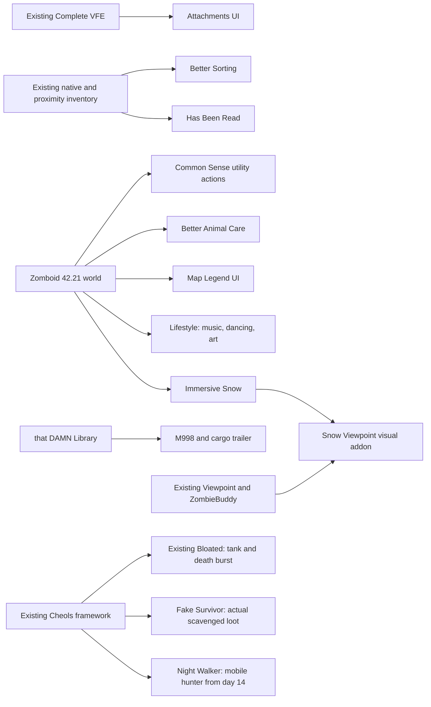

# Unstable expansion: QOL, social content and special infected

2026-10-25. User approved the nine recommendations and their dependencies, then requested a further community-supported mod survey and more detail on special infected. **Current field list: 30 Workshop references**, [public collection](https://steamcommunity.com/sharedfiles/filedetails/?id=3826875440), [manifest](../config/unstable.json), [fresh-world INI](../config/unstable/field.ini), [sandbox seed](../config/unstable/field_SandboxVars.lua). This adds 11 references for the approved recommendations/dependencies plus Fake Survivor and Night Walker. No running server, old save, global launch policy or original mod payload was edited. Friends' play remains the behavioral test.

Public metadata, actual installed `mod.info`, relevant Lua and sandbox definitions were inspected. Author claims are distinguished below from source findings. Subscriber figures are rounded **public API observations today**, not counts of current42.21 players, proof of reliability or a substitute for update/reply quality. The Cheols series is very new and lightly adopted; it does **not** have community maturity comparable to the large QOL mods.

## Approved recommendations now included

| Upstream item / Mod ID | Player benefit and evidence | Configuration / limitations |
| --- | --- | --- |
| [Attachments UI3816324722](https://steamcommunity.com/sharedfiles/filedetails/?id=3816324722) / `AttachmentsUI` | Visual slots/parts/statistics/presets. Author documents B42 SP/co-op/MP; installed minimum42.21. CVFE author explicitly supports its integration. About72k subscribers. | Client Mod Options control preview, UI sizing/input and presets. Ordered after CVFE as an integration relationship, not a claimed hard dependency. No new firearm framework or copied weapon patch. |
| [Has Been Read2544353492](https://steamcommunity.com/sharedfiles/filedetails/?id=2544353492) / `P4HasBeenRead` | Per-character unread/unfinished/useful-book and collection marks. Author confirms42.21 and MP. About2.90m subscribers; October update and author replies. | Native options choose marks, types and auto-marking. Keep native reading; no new XP reward. Map read status has a documented MP reconnect caveat. Separate **Viewpoint Inventory** addon is unsupported by this author; our base Viewpoint is not that addon. |
| [Better Sorting2313387159](https://steamcommunity.com/sharedfiles/filedetails/?id=2313387159) / `BetterSortCC` | More meaningful item categories alongside proximity looting. Author documents B42/MP. About3.31m subscribers, September update. | No extra Item Tweaker dependency in B42. Upstream category mappings/defaults retained; coverage for all new items is not guaranteed. Avoid another category/whole-inventory replacement. |
| [Common Sense Community Fix3717968421](https://steamcommunity.com/sharedfiles/filedetails/?id=3717968421) / `BB_CommonSenseFix` | Crowbar entry, equip from ground, fuel/washing and utility recipes. Author targets42.21 SP/MP but explicitly calls engine validation pending. About79k subscribers; October20 maintenance. | Exactly one Common Sense owner. Prying ON at normal multiplier, safe-door prying OFF, reinforced-door Strength8. Extra gun-stat UI and experimental bullet-removal actions OFF; Attachments UI serves weapon inspection. Other native utility defaults retained. Do not co-enable original/reupload forks. |
| [Better Animal Care3582024827](https://steamcommunity.com/sharedfiles/filedetails/?id=3582024827) / `EURY_ANIMALCARE` | Animal-zone actions and needs highlights. Author lists B42/MP; installed B42/42.15 branches. About17k subscribers, September update. | Per-client options set highlights/color. No livestock economy rewrite. Another mod replacing the animal-zone UI can conflict. Exact Viewpoint/42.21 interaction unverified. Existing subscription was restored after the incident below. |
| [Map Legend UI2710167561](https://steamcommunity.com/sharedfiles/filedetails/?id=2710167561) / `MapLegendUI` | Readable world-map building colors help expedition planning. Author documents42.20 and MP. About1.99m subscribers. | Toggle/resize native legend. Exact42.21 fit is a field inference, not an explicit current-build test. No reveal-all map or new map cells. |
| [Lifestyle3403870858](https://steamcommunity.com/sharedfiles/filedetails/?id=3403870858) / `LifestyleHobbies` | Music, dancing, meditation, art and homestead activities give the crew a reason to return home. Author says latest B42/MP; about460k subscribers. Uses tile definition5620; roughly1.4GB download. | **Current version, not legacy42.12.** Hygiene/bladder need multipliers0; comfort multiplier0/no impact; beauty decay/effect VerySlow/VeryWeak and no outdoors beauty; levitation removed, dynamic traits OFF. Native music/art/skill rates retained. Beauty needs are weakened, not fully disabled: no zero-strength option exists in inspected definitions. Dedicated-song/menu reports and large Viewpoint animation/UI interactions remain unverified. |
| [Immersive Snow3810071828](https://steamcommunity.com/sharedfiles/filedetails/?id=3810071828) / `ImmersiveSnow` | Footprints, tracks, snow and seasonal visual cause/effect. Current author documents B42.20+ dedicated MP; about157k subscribers with recent updates. | **SnowSlowdown=false**, **SnowWetness=false** initially: extra immersion without added movement/wetting penalties. Other lifetime/density/low-end/visual switches remain native. Does not cause snowfall or guarantee globally synchronized persistent tracking. |
| [Snow Viewpoint addon3816586790](https://steamcommunity.com/sharedfiles/filedetails/?id=3816586790) / `ImmersiveSnowViewpoint` | Required for intended first-person snow presentation; author targets Viewpoint0.1.6.1/0.1.6 and matching Snow0.5.2 Patch5+. About48k subscribers. | Requires Snow, Viewpoint and ZombieBuddy. **Author explicitly says MP untested**: included as a disclosed client-visual field exception, not verified MP support. Renderer mismatch is designed to stand down. A new Java hash needs each client's ordinary approval; no `allow-all` or approval-file change. Field-test rendering/performance. |
| [that DAMN Library3171167894](https://steamcommunity.com/sharedfiles/filedetails/?id=3171167894) / `damnlib` | KI5 dependency; author explicitly supports42.20+ SP/MP and maintains the vehicle suite. About3.19m subscribers. | Load before M998; upstream settings retained. Do not add third-party library fixes/reuploads by default. |
| [M998 + cargo trailer2642541073](https://steamcommunity.com/sharedfiles/filedetails/?id=2642541073) / `92amgeneralM998` | A useful expedition vehicle/trailer to find, restore and protect. Requires damnlib. About3.25m subscribers. | Base module only; extra/spawn-debug modules not enabled. Vehicle page's explicit MP support stops at42.13 while its current library supports42.20+; installed branches have no42.21 exclusion. Current42.21/Viewpoint vehicle rendering is **unverified**. Native distribution/parts/capacity retained; no automatic faction ownership/relic guarantee. |

These are additions to the preset and collection; subscriptions do not activate a server. Per-client options remain personal, and changed sandbox seeds apply to the new field world rather than silently migrating old caches. See [field installation](UNSTABLE_FIELD_GUIDE.md).

## What each special infected contributes

| Type | Behavior and meaningful response | Current decision / tuning |
| --- | --- | --- |
| [Bloated3808245444](https://steamcommunity.com/sharedfiles/filedetails/?id=3808245444) | Slow, conspicuous durable threat. Its death releases ordinary zombies: create distance before the final shot. A group can split attention between the tank and its release. | Already included. Easy:2×health, local cap2, death release5. Only Enabled/Difficulty are exposed. Author **PRETEST** visual sync remains a risk; no guaranteed relic or ordinary-zombie conversion assumed. |
| [Fake Survivor3810118747](https://steamcommunity.com/sharedfiles/filedetails/?id=3810118747) / `CheolsFakeSurvivor` | Appears human at a distance, scavenges actual containers by day, disappears on close approach and hunts at night with flashlight/screams. What it collected can be recovered from the corpse. This links a distinctive enemy to valuable loot without inventing a reward generator. | **Added.** Author42.21 MP. Source inspection found daytime-only natural creation through `CSI.spawnSpecialInfected`, an outdoor player-distance ring, persistent registry and client updates gated by its exact CSI type/UID. Chance10%, cap1, health multiplier1. These are natural attempt chance and configured identity cap, not measured world/capacity guarantees. Scavenging is not a Jeem faction service and may threaten stored supplies; base-policy interaction needs play feedback. About308 subscribers. |
| [Night Walker3814935581](https://steamcommunity.com/sharedfiles/filedetails/?id=3814935581) / `CheolsSpecialInfected_NightWalker` | Fast low-health hunter, windows/high fences/vehicles and second-floor routes. Curtains and barricades matter; a fence or upstairs room alone is not reliable protection. Native spawn safety checks distance; this is more mobile pressure, not a loot boss. | **Added, first appearance day14.** Author42.21/hosted-MP, dedicated/group feedback pending. Only `NightWalkerStartDay` is registered in the installed sandbox file. Source reads further keys but exposing/serializing those is not verified, so they were **not invented as functioning host settings**. Native defaults remain roughly10 total, waves3–5, per-player5, cooldown2hours, sleep protection; timing/population are not engine accepted. About102 subscribers. |
| [Rupturing One3816278415](https://steamcommunity.com/sharedfiles/filedetails/?id=3816278415) | Crawling pheromone recruiter/breacher. A roughly4second death warning offers a chance to move and turn its blast against followers. Can destroy obstacles, including high walls if trapped; defaults include12 companion zombies. | **Inspected/downloaded only, outside collection/profile.** Author targets42.21 hosted MP. Bandits exclusion is documented, A-Life exclusion is not. Recruitment/base-destruction/4second Viewpoint cue and native anti-cheat interactions need a separate decision. Optional ZombieBuddy swelling module not enabled. About98 subscribers. |
| [Gluttonous One3817839666](https://steamcommunity.com/sharedfiles/filedetails/?id=3817839666) | A corpse-feeding road obstacle releasing persistent toxic gas. Players can reroute or use a functional filtered mask; killing it provides antidote tea ingredients. Its first gas release has a50%chance to add a Bloated. | **Inspected/downloaded only, outside collection/profile.** Author42.21 SP/MP; requires framework+Bloated. Defaults10% road-sector chance, cap8, spacing120. Gas causes immediate sickness and leaving does not cure it. Viewpoint gas visibility, mask/filter enforcement, antidote ownership and extra Bloated pressure must be understood before adoption. About60 subscribers. |

All five use **Cheols' existing framework**, not Ian's similarly named framework. Source identity gates and independent spawning justify a field inclusion; they are not full coexistence/ownership/restart certification. No duplicate physical NPC owner, Random Zeds mutation, extra horde director, special-infected source patch, or custom V3 system is added.

Fake Survivor is the best current loot-chase match. Night Walker adds positional decision-making. Rupturing/Gluttonous are future encounter tools, rather than automatically adding every new enemy. Their small communities and recent fixes mean greater maintenance uncertainty despite thematic fit. Native death bursts/natural encounters add zombies outside Horde Nights' own counter; there is no claimed unified cap.

## Further community-supported candidates — research, not more automatic additions

| Candidate / public reach | Fit and controls | Support evidence / decision |
| --- | --- | --- |
| [Fitted Sheets3794207681](https://steamcommunity.com/sharedfiles/filedetails/?id=3794207681), ~262k subscribers | Fits sheets to large windows using vanilla curtain behavior. Useful visual reinforcement of concealment/base preparation, especially with Night Walkers. | Author explicitly documents42.20/42.21 and some MP testing; active comments. **Best next small candidate.** First-person custom tile appearance not inspected. On removal, take fitted sheets down first: otherwise they become invisible while still blocking sight. |
| [More Builds515555911](https://steamcommunity.com/sharedfiles/filedetails/?id=515555911), ~1.25m | Native B42 construction/furniture/storage/decor, material/skill requirements, search/favorites. Supports faction camps, social venues and long-term base projects. | Original maintained B42 refactor; October update and current author replies. MP-tagged but current floor-removal reports are being investigated. **Strong next content lead**, not an automatically deployed economy/power owner. Inspect cost/utility recipes and permission behavior. |
| [Authentic Z2335368829](https://steamcommunity.com/sharedfiles/filedetails/?id=2335368829), ~2.42m | Location-appropriate outfits, rare recognizable zombies and collecting goals. Stronger “find something memorable” content without a new AI framework. Choose exactly one Current/Lite/Backpacks branch. | Current author supports B42 and publishes compatibility/server discussions. Exact42.21/A-Life/special outfit identity interaction unverified; backpack attachment overlap and dictionary/update risks need inspection. **Prefer evaluating outfit-only Lite first**, not stacking all modules. |
| [Bushcraft Gear Tools2423906082](https://steamcommunity.com/sharedfiles/filedetails/?id=2423906082), ~1.83m | Six survival-friendly axes/knives/machetes; alternative useful melee finds. Original vanilla items retained. | Original author updated August30; server-pack permission documented, explicit current42.21 MP assurance not found. **Candidate only**, do not substitute a similarly named port without checking. New loot can increase overall weapon availability. |
| [Rain Cleans Blood2956146279](https://steamcommunity.com/sharedfiles/filedetails/?id=2956146279), ~1.77m | Weather gradually cleans blood/ash and optional clothing/vehicles/droppings. Native weather threshold, tile budget/rate and individual switches. | Author documents B42.20/server authority and is replying to users. Clothing-state/vehicle reports exist. **Candidate for world-cleaning only first**, with clothing/vehicle mutation OFF until understood; no automatic claim it fixes performance. |
| [SaucedCarts3651954650](https://steamcommunity.com/sharedfiles/filedetails/?id=3651954650), ~99k | Physical cooperative hauling, capacity/durability/repair/spawn knobs. Fits resource recovery and expedition roles. | Active author replies/discussions, designed for MP; October reports include equip/transfer and lost contents on break. **Watchlist until current fix/state clarified**, despite attractive design. Promotional “certified/no duplication” prose is not independent evidence. |

## Review and next useful action

- **HR-014:** each friend's Snow Viewpoint Java approval, renderer version fit and first-person/MP presentation; keep per-hash policy and omit the visual addon if it stands down or disrupts play. No account credentials needed.
- **HR-015:** decide after play whether delayed Night Walkers are enjoyable at their native wave settings; the additional source-read knobs are not registered sandbox options in the installed version. Do not silently promise adjustable max/waves in the normal host UI.
- **HR-016:** keep destructive breachers/toxic roads outside the main pack until A-Life protection and readable Viewpoint cues are established. This is a future encounter choice, not a blocker to the30-item field pack.
- Existing host/world/PvP choices remain in [HUMAN_REVIEW](HUMAN_REVIEW.md). No live deployment is implied. Community counts are dated observations; collect actual friends' observations rather than expanding indefinitely before play.

Subscription incident: the first batch used green button color and accidentally unsubscribed the user's preexisting Better Animal Care. Every pre-click screenshot was audited; it was the only already-subscribed item clicked. Restored it immediately, visually confirmed Steam's subscribed receipt and downloaded payload. The revised helper checks exact URL and button text, leaves already-subscribed items alone and verifies post-click state. No saves or server enable flags were altered.
