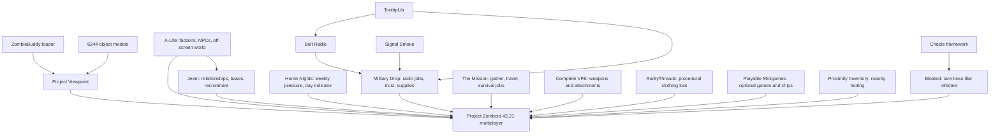

# Public unstable field pack — 42.21

Updated 2026-10-25 under [SC-006](SCOPE_CHANGES.md). [Subscribe on Steam](https://steamcommunity.com/sharedfiles/filedetails/?id=3826875440) · [Git branch](https://github.com/adrik0622/pokeys-100-days-gone/tree/unstable) · [exact manifest](../config/unstable.json).

This is the **17-item friends' content field-test pack**, separate from the hidden baseline collection and retained laboratory worlds. It deliberately includes promising existing content before combined gameplay acceptance. The public API returned the exact 17 members, visibility `0` (Public), successful item results and no bans. Steam's owner page also displayed a temporary automated content-analysis notice after publishing; Public selection alone does not prove moderation has finished.

Use **42.21**, a **fresh disposable world**, matching upstream revisions and 4–8 friends. The count is a target, not measured capacity. No game was launched or live server/world overwritten during this assembly. Prior tests apply only to their recorded older payloads and narrow scenarios. See [baseline status](STATUS.md) for those boundaries.

Arrows show dependencies/system contributions, **not invented cross-mod APIs**. Military trust and Jeem standing are separate native balances. Bosses do not automatically guard a specific relic, and factions do not automatically chase the best rolled jacket. The local Pokeys companion is **not required or included** here; its authored relay, repair/calibration and cross-mod credit features remain in the separate development lane. This keeps the collection usable through upstream subscriptions without silently promising an unpublished custom Workshop mod.

## What is included, and what supports compatibility

Each linked author page is a primary source. Installed `mod.info` and sandbox files were inspected; the observed payload fingerprints and update times are in [unstable-lock.json](../config/unstable-lock.json). That file records bytes seen locally; it cannot freeze future Steam downloads. **No whole-stack multiplayer certification is claimed.**

| Mod / Workshop ID | Contribution and dependencies | Build / multiplayer evidence and limits |
| --- | --- | --- |
| [ZombieBuddy](https://steamcommunity.com/sharedfiles/filedetails/?id=3619862853) `3619862853` | Java loader for Viewpoint; one-time setup beyond subscription | Author lists B42.21 and MP. Older local dedicated presentation join passed. Per-hash Java approvals remain required; no `allow-all` shortcut. |
| [Project Viewpoint](https://steamcommunity.com/sharedfiles/filedetails/?id=3809306528) `3809306528` | First-person presentation/aiming; requires ZombieBuddy | Earlier 42.21 dedicated join/rendering observed. Gun-hit correctness, new weapons, clothing stat modifiers and remote group play remain field questions. |
| [6244 3D models](https://steamcommunity.com/sharedfiles/filedetails/?id=3810302175) `3810302175` | Models improve first-person objects; use with Viewpoint | Installed B42 branch; same presentation slice observed earlier. Assets do not repair network hit behavior. |
| [Project A-Life](https://steamcommunity.com/sharedfiles/filedetails/?id=3803984183) `3803984183` | Sole NPC owner: persistent factions, scavenging, radio reports, patrols, robbery and conflict | Current author advertises **1.4.6**, B42.21 SP/co-op/MP. Earlier 1.4.5 contact/restart evidence is historical. Never combine with Bandits or general zombie-conversion mods. |
| [Jeem Extension](https://steamcommunity.com/sharedfiles/filedetails/?id=3806944055) `3806944055` | A-Life dependency; reputation, bases, residents, duties, missions, grief and relationships | Author says B42.21+, A-Life 1.4.5+, made for MP. Current defaults expose considerably more native content than the old narrow fixture. Recruitment/base life are field features, not previously accepted tests. |
| [Horde Nights](https://steamcommunity.com/sharedfiles/filedetails/?id=3782615002) `3782615002` | One recurring horde owner, calendar warning and pressure | B42 installed branch and prior actual dedicated event/aftermath observations. All its drop/Bandits options are OFF here. Loaded-event cap is not asserted to cap every zombie worldwide. |
| [TooltipLib](https://steamcommunity.com/sharedfiles/filedetails/?id=3694097672) `3694097672` | Tooltip dependency of Belt Radio; optional rarity UI integration | B42 installed payload; previously joined with the radio/drop fixture. No second inventory renderer added. |
| [Belt Walkie-Talkie](https://steamcommunity.com/sharedfiles/filedetails/?id=3817018338) `3817018338` | Wearable radio interaction; requires TooltipLib | Installed minimum 42.21; prior dedicated radio/drop path observed on older pins. |
| [Signal Smoke](https://steamcommunity.com/sharedfiles/filedetails/?id=3811010882) `3811010882` | Visible signals/flares/chemlights; now a required Military Drop dependency | Author states 42.21 SP/MP; installed minimum 42.21. Included explicitly, rather than relying on Steam to activate dependencies. |
| [Military Drop](https://steamcommunity.com/sharedfiles/filedetails/?id=3811752923) `3811752923` | Radio requisitions, military trust, noisy supply opportunities; requires all three rows above | Author states 42.21 SP/MP, server authority, mostly SP testing. **0.6.0 introduced required Signal Smoke on October 21**. Old 0.5.4 recovery/restart evidence does not accept current multiplayer behavior. |
| [The Mission](https://steamcommunity.com/sharedfiles/filedetails/?id=3640172314) `3640172314` | Optional objectives and rewards; native job UI/editor | Current author explicitly targets 42.21 SP/MP; installed minimum matches. Gather/travel/survival remain available; kill category OFF because NPC zombie bodies may be miscounted. No Pokeys contract bridge enabled. |
| [Complete Vanilla Firearms Expansion](https://steamcommunity.com/sharedfiles/filedetails/?id=3820580321) `3820580321` | Broad gun/ammo/attachment variety and rare equipment; no new aiming framework | Author says made on 42.21 SP/MP. Replaces VFE, STALKER/Post-93 packs and Improvised Silencers: **do not stack them**. Reference subscription only; no repacking. Author plans deprecation when official VFE is finished. Viewpoint interaction unverified. |
| [Playable Minigames](https://steamcommunity.com/sharedfiles/filedetails/?id=3716934959) `3716934959` | Pool, darts, cards, board games and Wordle; optional social play/casino with virtual chips | Author documents co-op/dedicated MP, reconnect grace and recently added Viewpoint support. Client minimum B42. Bots are game UI opponents, not a second physical NPC system. No chip-to-survival-loot conversion added. |
| [Someone called RPG?](https://steamcommunity.com/sharedfiles/filedetails/?id=3775673766) `3775673766` | Persistent clothing rarities/affixes, item progression and sockets; desirable tradable loot | Author says B42.20+ and server-authoritative MP ownership/transfer. No required dependency; TooltipLib supported. **Combat bonuses can affect gun balance**; disabling virtual stamina does not disable all effects. One rarity owner only. |
| [Proximity Inventory](https://steamcommunity.com/sharedfiles/filedetails/?id=2847184718) `2847184718` | One nearby-container/corpse view reduces looting friction | Author title targets B42.20+, description says MP supported. Client QOL; radius/container performance and Viewpoint usability are field observations still needed. Avoid stacking another proximity/container replacement. |
| [Special Infected Framework](https://steamcommunity.com/sharedfiles/filedetails/?id=3808244560) `3808244560` | Identity/registry and separate spawn support for Bloated; no content alone | Author/installed metadata target42.21 and MP structure. Inspected server spawning/identity code. This is **Cheols' framework**, not Ian's similarly named framework. |
| [Bloated](https://steamcommunity.com/sharedfiles/filedetails/?id=3808245444) `3808245444` | Rare distinctive infected; Easy selected. Requires Cheols framework | Author claims 42.21 MP, but labels **1.0.4 independent-spawn/visual-sync PRETEST**. Inspected source chooses a fresh outdoor square and creates a separate actor; no general zombie conversion. A-Life/MP identity/visual interaction still unverified. Killing one releases ordinary zombies; it has no guaranteed relic reward. |

## Start the field game

1. Everyone selects **42.21** in Steam and subscribes to the collection. Let downloads finish with the game closed. A collection does not automatically configure the host's server or enable the right Mod IDs.
2. Install ZombieBuddy once using its [author instructions](https://steamcommunity.com/sharedfiles/filedetails/?id=3619862853). Linux/macOS use the matching JAR and `-javaagent:ZombieBuddy.jar --`; Windows uses the author's installer/manual native-loader instructions. Preserve unrelated launch options. Review Java approval dialogs for Viewpoint; a subscription alone is insufficient. No client launch settings were changed by this assembly.
3. The host creates a **new named world/server**, e.g. `pokeys-unstable-field`, using the normal host UI or a separate dedicated cache. Select all 17 exact Mod IDs in [manifest order](../config/unstable.json), or use the `WorkshopItems=` and `Mods=` lines in [field.ini](../config/unstable/field.ini). Keep the normal `Muldraugh, KY` map; no RV/map add-on is included.
4. [field.ini](../config/unstable/field.ini) is a **template**, not a replacement for an existing server file. Set a real password privately, confirm unused ports and the friend-access method. Its Public=false controls server listing, while the Workshop collection is Public. It suggests PvP with the native safety system; host/friends should review this before play. It does not add faction penalties for player kills. Checksum stays ON; other security settings are not weakened.
5. Use [field_SandboxVars.lua](../config/unstable/field_SandboxVars.lua) as the fresh-world sandbox seed and inspect the generated full settings in the host UI. Omitted settings use upstream defaults. Calendar starts October17,1993; native three-month aging is a shorthand, not 100 simulated days. It is a survival preset, **not the zombie-free network fixture**.
6. Invite friends and play. Find a radio, inspect native A-Life/Jeem people/base menus and Mission objectives, search for useful weapons/clothing, and make a social stop at a pool table or cards. Read the horde-day indicator before expeditions. **Stay back when a Bloated dies: its death releases five ordinary zombies on Easy.** A late/ordinary-looking boss model is a known PRETEST concern; treat that as a field defect, not intended surprise design.

This guide does not start a dedicated host, configure WAN forwarding, select friends' platforms or deploy into an existing save. The source profile is ready for the host to choose the actual session. Do not share the password, raw saves or approval files in Git.

## Tuning handles and chosen starting values

All mod keys below were checked against the **installed** `media/sandbox-options.txt`; those files and their mod/version directories are part of the fingerprint record. Edit through Host→Sandbox or the **stopped, matching new server's** `Server/<name>_SandboxVars.lua`. A changed default does not migrate an existing cached world. Changes are proposals for the first session, not measured balance.

| System / namespace | Field values and practical effect |
| --- | --- |
| Vanilla | October17 start, three-month `TimeSinceApo=4`, one-hour days (`DayLength=3`, confirmed in installed vanilla translations); utilities off, moderate population0.5→0.75. Brings the late-outbreak setting without the old zero-zombie fixture. Native utility/loot/erosion behavior still needs ordinary play feedback. |
| `ALife` | `Preset_ExplicitValues=true` prevents preset overrides. Population rate/party100%, hostile ceiling16, initial population maximum40, simulation radius90. Keeps native living-world behavior while lowering the new upstream rate200%/party125% defaults. These are not a global NPC/performance cap. |
| `ALife` warnings | Warnings enabled, warning/raid chance100%, hold12seconds, raid lead6hours, first-contact grace3 and warning lead2; raid attackers max8. Uses existing author knobs for readable encounters; no guarantee every attack receives a warning. Expert defaults, driving and outpost systems are left upstream, not rewritten. |
| `ALifeJimmy` | Standing/fair blame ON, player reputation reset OFF, residents per base6. Native recruitment/base/donation/mission options remain available; experimental defaults stay as shipped. Gain/loss rates, shared-versus-crew standing, raids, resident needs and base protection are native tuning tabs. No custom PvP verdict layer. |
| `HordeNights` | First horde7days, interval7days,22:00–05:00, indicator ON.12 births/player base, day/event scaling0, active cap48, batches6, distance80–120, sprinters0. This is pressure with preparation time; active cap is not a promise about all surviving hordes/world zombies. All supply/helicopter/Bandits drops OFF so Military Drop stays the supply owner. |
| `MilitaryDrop` | Cooldown72hours (upstream168), guards3–12, destination200–500. Keep native radio/code/trust/requisition rules; random/storm/gunfire crash escalation OFF initially. Native Frequency/NumbersStationFrequency0 means author automatic selection, not a promised hard-coded channel. Requisition budget, trust thresholds, reports/recon/cleanup, decoy, smoke and crash options remain available; military trust is not Jeem standing. |
| `TM42` | Native jobs ON, custom files OFF, gather/travel/survival ON, kill category OFF, seven-day reset. Admin mission editor can later author goals/rewards/prerequisites/consumption/repeat behavior without a new code mod. No new authored mission shipped in this pass. |
| `VFE` | Gun/house multipliers1, vanilla guns retained, period restriction OFF for breadth. `PeriodCorrect=true` later removes post-1993 additions; category/distribution and attachment stats are exposed. Existing ammo/scarcity choices remain relevant; this is not an alternate ballistics framework. |
| `PlayablePool` | Nine standard games ON; beta-only games OFF. Solo/bots/spectators ON, casual pool,90second turns,120second reconnect grace, two-minute parked hold.50 starting chips and records ON; boredom relief5/turn (upstream18), stress/unhappiness relief0. No survival-item redemption. Per-client reaction/mute/input options preserve accessibility. |
| `RarityThreads` | Rarity multiplier1, all native tiers and drawbacks retained, existing inventory reroll OFF, virtual stamina OFF, debug OFF. Tier toggles/rarity frequency are the main balance knobs. Clothing can still modify damage/aiming/defense/encumbrance: watch this alongside Viewpoint/CVFE. This deliberately trials power loot under SC-006, not a final HR-003 balance decision. |
| `CSI_Bloated` | `Enabled=true`, `Difficulty=1` (Easy): source preset2×health, local cap2, death release5 ordinary zombies, natural density roll0.0005. Only Enabled/Difficulty are exposed sandbox knobs; the component values are source presets, **not additional editable options**. Disable Enabled before the next session if visuals/identity/pressure are disruptive; retain a backup rather than blindly deleting entity state. |
| Viewpoint/models/loader | Use author controls and per-client visual preferences; keep terrain/detail conservative if it obscures cues or hurts performance. Keep Java approval policy intact. No invented weapon-fix setting or automatic server-side acceptance. |
| Tooltip/Belt Radio/Signal Smoke/Proximity | Follow native mod/UI controls. TooltipLib has no campaign balance role. Belt radio is equipment/radio QOL; Signal Smoke provides visible navigation/signaling. Proximity's native toggle/highlight/force-selection settings control presentation; narrow scope if corpse piles stutter. |

## Dreams covered, and seams still missing

| Vision | Available in this field stack | Still missing / alternatives surveyed |
| --- | --- | --- |
| Living factions and meaningful choices | A-Life patrol/scavenge/robbery/conflict plus Jeem relationships/base crew | Contextual witnessed player-kill attribution and a bespoke morally gray faction are not delivered by assembling subscriptions. Keep HR-001/002. |
| Reasons to travel and desirable loot | Native missions, radio supplies, varied firearms and procedural clothing | No verified automatic named-relic pursuit, contested unique-world ownership or boss→high-tier-cache binding. Incidental NPC competition is not intentional relic hunting. |
| Distinctive threats | Independent-spawn Bloated on Easy, scheduled hordes, native hostile factions | Boss loot guarantees need a supported config/API or a later small original event bridge. No custom implementation now. |
| Casino/social relief | Blackjack/hold'em virtual chips, pool/darts/board games and spectators | A physical casino venue/economy and faction stakes are not supplied. Avoid a second overlapping pool/casino framework initially. |
| Travel comfort / van interiors | Proximity looting and existing vehicle survival | See RV comparison below; no seamless walk-through transition verified. |
| Road tolls / ambushes / recoverable traps | A-Life already supplies roaming armed encounters/robbery; warning knobs raised | [Bandits Tactical Expansion](https://steamcommunity.com/sharedfiles/filedetails/?id=3782988545) advertises toll/ambush tools but requires **Bandits**, the competing NPC owner. Do not add to this A-Life pack. Specific faction toll accounting/nonlethal traps remain unimplemented ideas. |

The smallest later custom concepts would be (a) one server-owned named cache receipt tied to a supported boss death/mission reward, and (b) an explicit A-Life faction claim/knowledge handoff **if an actual supported API exists**. Neither requires a second physical director; both need identity/replay protection and visible warning. They are pitches only, not implemented or counted in this collection.

## Optional candidates kept outside Subscribe All

| Candidate | Author fit / dependencies / knobs | Decision |
| --- | --- | --- |
| [Project RV Interior](https://steamcommunity.com/sharedfiles/filedetails/?id=3543229299) | B42 MP/SP; `PROJECTRVInterior42`, `map_distanciado` first; author calls for `DoLuaChecksum=false`. Interior/power/vehicle settings; transitions are a menu/teleport system. | Not adopted: do not silently turn checksum off for this convenience. |
| [Project RV Interior Rebase](https://steamcommunity.com/sharedfiles/filedetails/?id=3712739345) | MP-oriented server authority; requires original Workshop assets; `ProjectRVInteriorRebase` plus optional expansion modules. New data model cannot reuse original assignments. | Promising alternate RV owner. Confirm current42.21 instructions and whether base assets can be loaded without its runtime/checksum workaround. Never stack RV owners. |
| [Arcadia RV Interiors](https://steamcommunity.com/sharedfiles/filedetails/?id=3773972040) | Author documents42.20 SP/hosted/dedicated MP; core `ArcadiaRVInterior_B42_MP` then `..._Vanilla`; map `vehicle_interior_arcadia75` first. Power/battery/entry/recovery/admin knobs; author lists anti-cheat speed/no-clip settings4. | Best separate fresh-world RV proposal;42.21/Viewpoint support not explicitly confirmed. Preserve old maps/assignments; no live save conversion. |
| [Fake Survivor](https://steamcommunity.com/sharedfiles/filedetails/?id=3810118747) | Cheols-series lead for scavenging/loot competition; requires current author/source confirmation rather than assuming Bloated's architecture applies. | Research lead only. No authoritative current42.21/MP/API confirmation obtained in this sweep; not subscribed/enabled here. |
| [Ian's framework](https://steamcommunity.com/sharedfiles/filedetails/?id=3780939820) + [Howler](https://steamcommunity.com/sharedfiles/filedetails/?id=3780939914) | Different framework/attraction owner from Cheols. Previously researched MP design does not prove lifecycle/stack behavior. | Keep outside this first special-infected stack; avoid overlapping frameworks/directors. |
| [ApocalipseBR Regiões](https://steamcommunity.com/sharedfiles/filedetails/?id=3706462687) | Earlier author/source research found server-oriented region/boss authoring; event/region configuration, not automatic faction relic pursuit. | Possible later event/guardian route, not added alongside current horde owner without inspecting overlap. |
| [Random Zeds](https://steamcommunity.com/sharedfiles/filedetails/?id=3778522347) | B42 zombie variety; whole-zombie mutation can touch NPC bodies. | No verified A-Life exclusion; do not add because an MP tag alone looks reassuring. |
| Equipment UI `2950902979`, Usable Pool `3778877053`, Bar Room Games `3790170013`, Imperium Casino `3755213631` | Inventory/social alternatives; original Equipment UI is now explicitly discontinued. Other casino/pool candidates need their own current dependencies/build check. | Proximity + one broad minigame pack already serve the immediate role. No duplicate inventory or pool owner. |
| Save Our Station | No verified released B42 port in the research record | Do not install the B41 map to fill a feature checklist. |

## Visible review queue and field feedback

No routine approval is needed to use the prepared upstream list. The remaining choices are: **fresh world versus preserving an existing campaign**, actual host/platform/access details, PvP/safety preference, whether combat-stat clothing feels right, and whether to schedule a separate RV world. No live world or server has been selected/changed on the user's behalf. HR-001/002/004/009 remain product questions; HR-010 still applies only to the separate companion lane.

During ordinary play note the mod/update time and what happened, especially NPC warnings and remote identity, aim/damage with rolled gear, Bloated visual sync/death births, supply claims and minigame reconnect. Stop/change only the feature causing trouble and retain the world/log privately. This is a lightweight feedback list, **not a request to postpone the field test for another lab campaign**.

Correction to older research: Steam pages contain hidden removed/incompatible warning templates. Merely seeing those strings in extracted HTML was not reliable evidence of delisting. Public API and actual fresh subscriptions/downloads succeeded for Military Drop, RarityThreads and Cheols' framework. HR-011's former availability premise is resolved for this assembly; old source/runtime observations remain attached to their old fingerprints.
