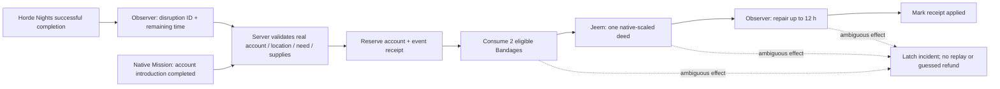

# V2-05 — bounded recurring relay relief

2026-10-19, implementation design following [V2-04](V2-04-recovery.md). This is current V2 connected-recovery work, not V3, an economy, a second quest framework or an NPC rewrite. Runtime results must be recorded separately from source/mocked checks.

## Gap and smallest useful choice

The native introduction is once per account. The Mission's pinned server only writes `history.completed[id]` for one-time missions; repeatable gather has neither a durable completion counter nor a public completion event in the inspected path. Its private reward handler is not an acceptable guessed receipt. Resetting history, polling client success or globally intercepting game messages would weaken ownership/replay guarantees.

Keep that introduction unchanged. Add one explicit **Donate 2 Bandages for recovery** action, default OFF under `PokeysV2.RepeatRelief`. It is available only to a living, introduced player at the relay while an actual observed Horde Nights completion has left a disruption. Each native account may contribute once per disruption event. Two clean, non-favorite, unequipped main-inventory Bandages cost 12 world hours of repair and a modest existing Jeem EMS deed; no item/XP reward is minted. The server obtains the account, event, items, rate and result; caller-supplied values cannot change them. Once the relay is healthy, further donations are refused before consumption. Natural 24 h recovery remains the no-cost opt-out.

## Ownership and recovery boundaries

- Horde Nights remains the horde owner; the existing observer remains the only disruption/repair owner. Record a `disruptionEvent` only when the observer actually accepts a spawned, successfully completed event. An abort/baseline must not relabel an earlier incident. Older observer data without this optional field is **not** backfilled from `lastEvent`; active recurring relief waits for the next known successful event. No standing/save reset or inferred history migration.
- The Mission owns the unchanged introductory gather/reward; Jeem owns all faction standing. This action is an original world-condition interaction, not a second copy of the native contract/payout or a reputation mirror.
- Separate `Pokeys100DaysGone.V2Relief` schema-1 receipts, capped at 4,096 contributions without pruning, protect account + event identity. Reserve globally before the first removal, record consumption/phase, and keep an incident/pending latch after any ambiguous partial effect. Reopen refuses malformed state and never resets it. A full ledger refuses new donations rather than erasing replay protection.
- Only recurring donations are paused by an ambiguous relief incident. Existing aid still follows its own native-introduction, standing, recovery and shared-cooldown checks; no new punishment or universal service lock is inferred. No operator reconciliation tool is introduced; HR-010 applies to manual inspection.
- Enable only in the isolated recovery fixture, with its completed 0.4.1 offline checkpoints retained. Do not change the private collection, retained V1 worlds or unrelated profiles. Defaults remain OFF elsewhere.

## Verification card

1. Pure rules and actual-server-adapter mocks: disabled/corrupt/unavailable ledgers; no active need/unknown event; wrong location/dead/not introduced; missing, favorite, equipped or dirty supplies; forged account/event/reward/count; one contribution per account/event; second account and next real event; abort must not mint an event; restart reopen; full ledger; injected removal/sync/standing/repair failures and nested requests. Separate these from real process/network evidence.
2. Fresh processes, preserved recovery world: both ordinary accounts are already introduced. Admin forces/completes exactly one further one-birth event away from the relay, then exits normally. Confirm the observer records the new disruption identity. Ordinary A's new donation repairs 12 h without replaying the old Mission or granting wipes; its repeat is refused with no further consumption/standing. Clean restart; A still cannot replay, and B can repair remaining need once. Healthy relay refuses further Bandages. Preserve existing aid cooldown/bottle and all receipts.
3. Save/quit normally and retain raw offline checkpoints plus concise screenshots/log hashes. No fought-horde, NPC guard, natural loot, simultaneous client, hard-crash or release claim follows from the above.

Larger open V2 gates remain in [STATUS](STATUS.md) and [human review](HUMAN_REVIEW.md): physical/contested encounters, contextual violence policy/attribution, concurrency resources, drop availability/adoption and ordinary repeated survival cycles. This bounded feature does not silently waive them.

## Source / mocked verification

Companion source **0.4.2**; **73 project checks pass**, including Lua 5.1 syntax, the new actual-server-adapter harness and default-off/profile-scope checks. The 16-profile manifest validates. The receipt harness covers forged requests, location/life/introduction checks, protected/dirty items, no-need/unknown-event refusal, two accounts/new events, abort identity, mocked serialized reopen, corrupt/unavailable/full ledgers, clock rollback, nested requests and nine partial-effect fault modes. Reservations and incidents survive mocked reopening without repeated removal/standing. These are **not** live client races or hard-crash serialization evidence.

Pinned native Jeem inspection confirmed two important API contracts before runtime: `Standing.rate` returns a multiplier (the new action uses one base point), while `Standing.add` returns **before/after labels**, not numeric points. Receipts validate/store those labels; total points are still read from Jeem. No upstream source was copied or edited. Main-inventory/unequipped checks and removal notification use native APIs already present in the game/project.

The recovery fixture explicitly enables the option in source. Its existing cached server option was changed while stopped, after the retained 0.4.1 offline checkpoints. Earlier introduction evidence remains tied to 0.4.1.

## Engine observation — in progress

Native Build 42.21.0, source **`47a7856` / 0.4.2**. Server **703647**, native admin client **703716**: the same Relay Controller rejoined at the saved event site, away from the relay, without a new NPC spawn or world reset. Exactly one further Force/Complete sequence produced event **2 SOUTHEAST**, native budget/cap/birth **1**, route **1**, kills **0**, survivor **1**, drops false; observer recorded a new 24 h disruption. Earlier event-1 survivor was not removed. These bounded births are not a global-survivor-cap or fought-horde result. Admin exited 0.

Fresh ordinary A **705330** rejoined the existing **Alpha Recovery**, first introduction still completed/applied, native points **1.56**, shared aid cooldown **47.3 h**. New event 2 / **23.7 h** recovery was visible. A first recurring click without Bandages was explicitly refused, with no visible standing/item change or applied-contribution log. One new fixed two-Bandage fixture was then supplied for this distinct action; visible inventory showed `Bandage (2)` and only the old Alcohol Wipes. One Donate click consumed both, carry weight **1.70→1.50**, increased native points to **3.12** (actual deed **1.5625**) and reduced recovery to **11.6 h**. Native log: one `recurring relief applied event=horde:2 by=pokeys_recovery_a`. A repeat click said already helped this event; weight/standing remained unchanged and the old aid cooldown continued at **47.1 h**. No new native Mission completion, introduction deed, wipes or aid bottle was issued.

Ordinary A then began and cancelled the optional observer calibration. The panel showed **Calibration cancelled; baseline warning remains available**, retaining the 4-world-hour baseline window (**87.84–91.84 h** in that refresh). This is cancellation evidence in the selected five-mod composition, not movement/death interruption. A and server exited 0 / zero players / no listener. Preserved the partial contribution offline before restart.

Fresh server **707226** loaded the saved observer/bridge/relief receipts normally. Fresh A client **707293** rejoined Alpha without creation, supplies or Mission claims. The relay retained points **3.12**, event **2**, **11.3 h** recovery and **46.8 h** aid cooldown. A recurring click was refused as already helped this event; weight stayed **1.50**, no extra contribution/standing log. This directly checks the event/account key through actual engine serialization and clean processes, not merely a mocked reopen.

On that fresh process the existing screenshot/OCR-only `scripts/calibration_smoke.py` completed the displayed channels in **17.47 s**, reporting **Signal locked**. Visible forecast **89.27–89.77 world hours** was calibrated (0.5 h width); no supplies/item/deed were required or awarded. The earlier cancellation's transient session/cooldown was not revived by restart. A exited 0; server stayed running/pauses when empty for B's separate session. Shared benefit and B's independent repair remain in progress.
