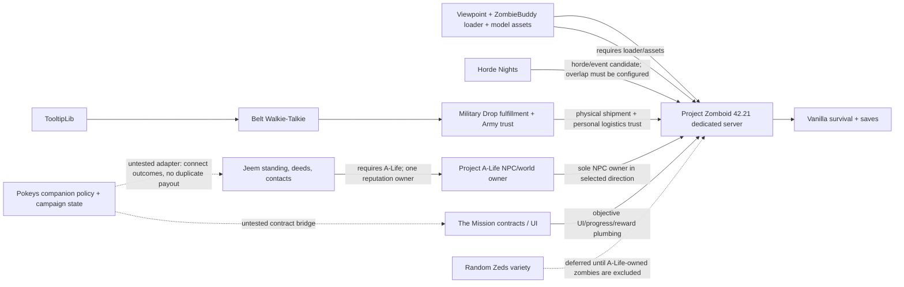
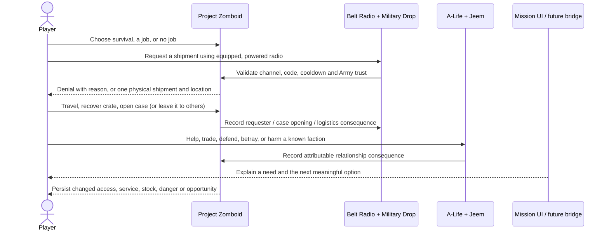
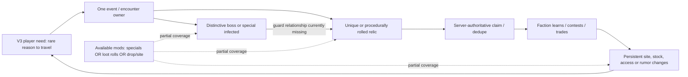

# Pokeys 100 Days Gone — V2 implementation and V3 mod-scene report

**Research snapshot:** Project Zomboid Build 42.21.0, revision `4a0e9546ec`; Workshop pages and installed payloads observed October 2026. **Audience:** project owner / human review. This report documents the current V2 direction, the actual implementation state, and a separate V3 research lane. A V3 candidate is not an adopted feature or a scope change.

## Executive read

V1 remains the foundation and is **not accepted**. Its first-person/presentation, survival, faction, horde, recovery and optional-interaction gates remain in the project status record. V2 is the connected living-world expansion: faction needs and jobs, persistent consequences, one contested supply loop, and optional activities whose rewards do not make ordinary survival worse. V3 is provisional depth; this report researches rare loot and memorable guardians without adding them to scope.

The strongest V2 evidence is an ordinary-player Military Drop cycle: Morgan requested a medical shipment by radio, physically recovered and opened its case, received medical supplies, gained delivery trust, was refused a second request during cooldown, and retained inventory through a clean dedicated-server restart. The NPC/reputation direction is Project A-Life + Jeem, replacing Bandits as the one NPC owner in that candidate profile. A native contact/gift/restart was observed, but it is not yet a fully integrated ordinary-player faction contract. In an isolated `contract-trial`, the 0.4 bridge registered one custom The Mission gather contract; the ordinary player completed its two-bandage delivery and received Alcohol Wipes, and The Mission still marked it Done after a clean restart. **Jeem credit did not run in this profile** (Jeem/A-Life were absent), so this is only a Mission+companion contract slice, not a connected faction loop.

The existing workshop collection is hidden and contains only the three presentation references; new V2 items are pinned trial candidates and must not be confused with collection members or a release stack. The local settings catalogue contains 1,091 upstream declarations from nine inputs. It is the practical source of truth for exact names, types, defaults, ranges, pages, source files and fingerprints; this report summarizes recommendations rather than duplicating a thousand-row appendix.

## Roadmap and evidence labels

| Stage | Current meaning | Report treatment |
| --- | --- | --- |
| V1.0 | Foundation: reliable multiplayer, presentation/gunplay, minimal factions, horde pressure, recovery, optional calibration | Still in development; V2 work does not waive or pass V1 gates |
| V1.1 | Readable, killable directing leader (SC-001) | Deferred; not required for the V1.0 gate |
| V2.0 | Connected needs/jobs, changing world state, consequential relationships, contested supply, optional incentive | Active direction; tested slices and untested code are labeled separately |
| V3.0 | More event/mission combinations, locations, strategies and possibly richer simulation | Provisional research only here; no feature adoption or implementation |
| V4.0 | Major polish | Provisional ordering; correctness and accessibility remain continuous work |

Evidence terms used below:

- **Runtime observed** means the named local Build 42.21 isolated fixture performed that behavior. It is not broad compatibility or player-capacity acceptance.
- **Source inspected** means the pinned local Workshop payload contains the described code/configuration seam. It does not prove an engine path works.
- **Author states** means the Workshop author documents the claim. It can guide a trial but is not our compatibility result.
- **Inference / review** means a design implication or a human choice, not a verified behavior.

## System map

### Current foundation and V2 candidate owners

Solid lines indicate an existing dependency/owner relationship or tested server interaction; dotted lines are untested integration targets. The rendered evidence base is not one accepted all-mod stack: tests used isolated worlds to keep NPC, horde, supply and presentation ownership from colliding. Military Drop's case trust is separate from Jeem reputation. Do not add another drop owner or NPC owner to the same world.

### Intended V2 player loop

The final two lines are the V2 product goal; the full loop is not yet implemented. A Mission objective must not pay a second reward for an outcome already paid by Jeem or Military Drop.

## Inventory: what is active, retained, or only a candidate

“In inventory” below means subscribed/pinned locally. The hidden collection currently has three verified members: ZombieBuddy, Viewpoint and PZVoxelStudioViewpoint assets. It is not the whole modpack.

| Mod / Workshop ID | Role and project fit | Compatibility, dependencies, interaction and limits | Practical knobs and recommendation | Evidence |
| --- | --- | --- | --- | --- |
| **ZombieBuddy** / 3619862853 | Java loader for Viewpoint; supports first-person presentation and the realistic-gunplay pillar indirectly. | Required by Viewpoint. Server/client Java loader behavior and dedicated join were observed. Other Java mods/allowlists are a separate approval surface; no blanket permission policy. | No gameplay tuning recommended. Keep only where Viewpoint is enabled; review its required-item Java allowlist against the exact pinned JAR. | Runtime presentation/dedicated/combined join; combat damage remains unaccepted. Payload pinned in `config/modpack.json`. |
| **Viewpoint** / 3809306528 | First-person camera, arms/weapons presentation and gunplay foundation. | Requires ZombieBuddy and the matching model assets. Native Build 42.21 trial rendered and joined dedicated server. Existing shotgun hit-square warnings mean target damage and shared combat are not accepted. Camera/crosshair/aim settings are client/game option surfaces, not rows in the Lua sandbox catalogue; inspect the Viewpoint options in-game for each client. Potential weapon/firearm patches and UI overlays need exact-stack checks. | Retain first-person as the intended presentation. Do not add a second firearm overhaul to mask damage uncertainty. Keep aiming aids/accessibility settings visible to players; test one vanilla firearm per damage path before tuning. | Runtime visual/UI and dedicated join; exact combat gate is a known limitation. Payload hash is in manifest. |
| **PZVoxelStudioViewpoint assets** / 3810302175 | Models/assets consumed by the Viewpoint presentation. | Asset dependency for the tested Viewpoint appearance. Large payload (~451 MB); not a gameplay system. Individual asset completeness is not audited. | No settings. Include only in Viewpoint profiles. | Loaded in GUI trial; all assets / multiplayer appearance not exhaustively verified. |
| **Horde Nights** / 3782615002 | Existing V1 horde/event owner and candidate V2 ambient pressure. Helps consequential travel and timed decisions. | Must remain the one horde birth/routing owner. Its current loaded-event cap does not account for prior/unloaded survivors; last-target departure can allow births while another group remains. Do not overlap its supply-drop path with Military Drop. | Current isolated samples: small four-birth/debug event; supply drops off in the Military trial; no candidate production cap accepted. Tune schedule, warning, direction, horde size/variant, event duration, empty-server behavior and rewards only in explicit server sandbox profile. Keep no-birth or abort policy conservative pending B-004/B-005. Exact declarations are in `V2_SETTINGS.csv`. | Native scheduled/forced event behavior was observed in isolated V1 fixtures; cross-event/global budget and ordinary player contest remain open. |
| **Bandits2** / 3268487204 | Retained V1 NPC comparison/rollback owner. | Not co-enabled with A-Life. One real armed hostile encounter occurred, but repeated server command handler `Expected a table` exception blocks dependable behavior. It is absent from all A-Life profiles and is not the selected direction. | Keep the old isolated profile/save for comparison only. No tuning or new stack integration until B-002 is diagnosed. | Actual encounter plus repeat server error; not accepted for V2. |
| **Project A-Life NPCs** / 3803984183 | Selected V2 NPC/world simulation direction: persistent logical squads/factions with physical shells near players. Supports persistent world identity and faction encounters. | One NPC owner: replace Bandits in a distinct world/profile. Installed folder says 42.20 but `versionMin=42.21`; server/admin source exposes factions, squads, persistence and shell lifecycle. Jeem detects native A-Life generation and stands down on overlapping features. Random Zeds does not recognize the A-Life UID by itself. Viewpoint adapter exists but is untested. | For the present test use no raids, encounters/outposts/support/revenge/warfare, reduced squad budgets (4), residents/raids/traders off in Jeem trial. `PopulateOnStart=1` means **Off**. These are test settings, not release settings or a zero-population guarantee. Tune population/squad/raid/seed/streaming/faction options in server `SandboxVars.lua`; full names/ranges in CSV. | Source inspected; core and A-Life+Jeem native contact/gift/restart observed. NPC movement/appearance changed over restart; combat/handoff/Viewpoint and ordinary attribution remain untested. |
| **Jeem Extension** / 3806944055 | Adds standing, first-hand reputation vs rumor, deeds, NPC opinions and relationship-facing services. Directly supports consequence and persistent faction access. | Requires/loads after Project A-Life. It is not a second NPC owner. Standing has own bounded labels/pools and event integration. Player-death hooks do not prove killer attribution for PvP. No universal anti-PK policy is implied. | Trial enabled standing/one-reputation; resident bases and traders disabled. Core API applies faction-specific gain/loss rates, label thresholds, witness/rumor decay and group sharing. Preserve defaults until ordinary actions and violence attribution are tested. Use settings catalogue and source manifest; do not change saved group-standing schema as a side effect. | One native bandage gift consumed: Jeem standing +3, NPC opinion +17→+19; same UID generation rehydrated after fresh restart, one bandage retained, opinion +27. Deferred +8 is a source-supported timing explanation, not exact persistence acceptance. |
| **TooltipLib** / 3694097672 | UI support dependency for Belt Radio/Military Drop tooltip behavior. | Required through Belt Radio metadata chain. No standalone gameplay. Keep matching server/client payload. | One `EnableMPSync` sandbox switch plus client tooltip detail modifier (`Shift`) in upstream settings; use default unless a concrete tooltip/sync problem appears. | Source/payload inspected and dependency chain confirmed; not separately gameplay-tested. |
| **Belt Walkie-Talkie** / 3817018338 | Receive-only belt radio, battery/noise tradeoffs; supplies Military Drop's radio interaction. | Requires TooltipLib. Radio eligibility/noise/range integrates with Military Drop request validation. Do not assume the receiver sends a request itself. | Six declarations cover battery drain, audible reception, noise radius, received MP bubble, SP belt reception and recharge time. Keep modest defaults; test whether belt convenience adds noise or removes the intended equipped-radio commitment before enabling it as a shortcut. Exact keys and ranges in CSV. | Military trial used the native handheld radio, not the belt radio; source inspected, feature integration not runtime verified. |
| **Military Drop** / 3811752923 | Requested physical supply drops, case contents and Army logistics trust. Supports contested expeditions, radio play and visible consequence. | Requires Belt Radio, which requires TooltipLib. Chosen as the only requested-drop owner; turn Horde Nights' overlapping drops off. Personal trust is separate from Jeem and vanilla player faction. New drop zombies are not under a proven shared birth budget. | Test fixture: 900 MHz, auth disabled, 40–60 tile range, one case, zero drop zombies; trust starts 25, `RequisitionBudget=25` means 25%, yielding 2 points, not 25. Release planning should raise travel/risk, use code/auth, cooldown and scarcity, and budget births; do not copy fixture conveniences. Sixty-four declarations include frequency, code/auth period, cooldown, placement/range, case lots, trust erosion, zombie counts, smoke/crash/decoy/salvage/Fulton and debug. Read HTML/CSV then change only one owner-controlled variable at a time. | Ordinary radio request → physical crate → medical case opening → three medical items and trust 25→35; second request refused cooldown; fresh-process restart retained inventory. No ordinary horde/NPC contest, auth puzzle, third-party recovery, trust audit after restart or capacity tested. |
| **The Mission** / 3640172314 | Contract objective UI, authored objectives, item requirements/consumption and progress/reward ledger; could present faction jobs without building a full quest UI. | No required mod dependency. Author targets 42.20.4, not a blanket 42.21 certification. Source: gather inventory validation and server reward claims; character progress vs completed history use different identity layers (history prefers Steam ID then username). Walk progress accepts client snapshots; zombie kill hook does not exclude A-Life shells. Native custom mission definitions reset at module init and can be appended through runtime API. Avoid its default grind/reset and never duplicate Jeem/Drop payout. | Isolated test profile is gather-only: kill/walk/survive/refill and auto-reset off; custom definitions on only for the companion fixture. Native builder fields include ID/type/title/description/target/required item/consume/sort/repeat/prerequisite/reward. Production recommendation remains a fixed medicine delivery/relay repair whose server-observed effect changes a faction need. | **Runtime observed on 42.21:** custom `County EMS - first relay delivery` appeared in UI, ordinary account accepted it, received two fixture bandages, completed the objective, surrendered both, and claimed one Alcohol Wipes reward. After clean client/server restart, the same account saw it marked Done, not Available; no reward replay was observed. Does not prove exactly-once behavior through crash timing, Steam identity migration, multi-client race, Jeem/A-Life integration, or broad 42.21 compatibility. See [V2-02 trial](V2-02-supply-contracts.md#contract-trial-custom-definition-consumption-reward-and-restart--observed). |
| **Random Zeds** / 3778522347 | Day/night/weather-conditioned zombie variety and stat/speed profiles. Can make travel and event pressure less predictable. | Current candidate for 42.21 (Random Zombies predecessor was retired for B42). No required dependency; optional Synapse adds Java/API surface and is not recommended initially. Its exclusion flag is `RandomZedsExcluded=true`, but no native A-Life detection exists. It hooks zombie creation before A-Life UID assignment, so a late check alone misses the first mutation. | Use built-in native random-speed options first. If trial proceeds, add a narrow original adapter to mark/skip A-Life shell creation and test birth, unload and rehydrate; keep Synapse absent. Tune day/night/weather proportions, per-type weights and exclusions in its server sandbox options (full list in catalogue). | Source/payload inspected; not enabled with A-Life and not runtime accepted. |

### V2 feature source state: exact implementation boundary

1. **Military Drop slice — observed.** `docs/V2-02-supply-contracts.md` records the controlled dedicated test, screenshots and missing gates. The world was deliberately quiet to prove normal delivery, not to demonstrate contest.
2. **A-Life/Jeem slice — observed narrowly.** `docs/V2-01-alife-jeem.md` records the visible medic, conversation, consumed gift, standing/opinion and rehydrated UID. It is a native-admin fixture and not ordinary access, hostile consequences, combat, PvP or cross-owner acceptance.
3. **The Mission + Pokeys 0.4 contract slice — observed in isolation.** `contract-trial` staged the companion with The Mission only. Custom definition registration, ordinary gather completion/consumption/reward, and Done status after fresh process restart were visible. The finite admin supply command supplied exactly two bandages for the fixture; they were not earned from survival. No Jeem/A-Life owner was enabled, so faction credit remains untested and was intentionally deferred.
4. **Pokeys 0.4 faction credit/aid bridge — source present and pure-rule-tested, only partially runtime exercised.** It proposes one `pokeys_medical_relief_01` gather contract: bring two bandages near the County EMS relay, consume them through The Mission, then credit a single Jeem deed. A periodic server reconciliation reads The Mission's completed-history key, reserves an idempotent campaign grant before applying standing, and records incidents rather than retrying ambiguous partial effects. Friendly/allied County EMS can request one disinfectant at the relay with a 48-hour shared cooldown. The client panel reports only known state; it does not claim that physical NPCs defend the relay. This design avoids a new reputation ledger and does not claim anti-PK behavior.

   **Risks to resolve before calling the faction loop V2 gameplay:** the bridge's Jeem credit and aid action were not exercised; the reward/history and standing update are not one atomic transaction; shared aid must not duplicate on failure; current scanning inspects the first 16 online players rather than a rotating set. The intended mission uses the current test NPC faction identifier `alife_county_ems`; verify this is a stable upstream contract before making it persistent project data. No integrated A-Life+Jeem+Mission profile has passed.

5. **Random Zeds bridge — not written.** Avoid enabling it with Project A-Life until an adapter intercepts shell creation before initial animation/profile mutation and proves that the right physical NPC remains excluded after restart/unload.
6. **Player-kill consequences — not implemented.** Jeem/A-Life has contextual NPC deed/reputation seams, but no accepted, tested end-to-end player killer attribution. There is no anti-PK design; factions may value an event differently. Defer consequence policy migration and PvP tuning until cause, actor, witness knowledge and repeat protection are reliable.

## V2 optional minigame and quality-of-life candidates

These are optional candidates, not current mods in the collection. The principle is that skipped vanilla survival remains useful. A minigame may trade time/noise/parts for narrower information or a modest convenience; it must not become a mandatory reflex gate.

| Candidate | What it adds / fit | Version, MP, dependencies and conflict surface | Knobs and practical recommendation | Evidence / decision |
| --- | --- | --- | --- | --- |
| **The Best Lockpicking [B42.21]** / 3745815281 | Pin-tumbler lockpicking, crowbar/bolt-cutter options, lockpicking skill and padlocks on doors/windows/crates; offers a high-stakes optional route into places. | Author page reports v3.13 validated on 42.20.4+, SP/MP support, server-authoritative XP, persistence. No stated required mod. Must not co-enable its listed predecessor ports (original Better Lockpicking, zRe variants, PH port). May overlap Common Sense crowbar or Immersive Hotwire. 42.21 exact-stack not yet tested. | Settings include new/old puzzle mode, XP multiplier, disable crowbar, disable security-door crowbar, disable mod hotwire, submenu merge, bolt-cutter toggle and minimum Strength/Nimble/Lockpicking. Trial with mod hotwire disabled, a skill-book/tutorial path and accessible non-reflex option; keep native entry viable. | Author documentation: [Workshop page](https://steamcommunity.com/sharedfiles/filedetails/?id=3745815281). Good first minigame spike after contract loop. Human review needed for whether lockpicking replaces native hotwire in final rules. |
| **[B42] Project RV Interior** / 3543229299 | Walk/drive into interior spaces for vans/trucks; creates a convincing mobile base and trip-planning convenience. Supports long sessions and expedition identity. | Author claims SP/MP, >200 interiors, battery/electric, rain collection, customization and split-screen. Server requires `PROJECTRVInterior42` and `map_distanciado;Muldraugh, KY`, `DoLuaChecksum=false`, Workshop ID in server config; author says load first and warns against challenge modes. Map/interior ownership, cell changes, save migration, split-group behavior and current exact stack untested. A-Life source compatibility helper mentions RV Interiors and removes nearby zombies during interior transitions; confirm this current mod follows that same seam. The old `RV Interior` 2822286426 is explicitly not updated for B42—do not use it. | No setting-by-setting audited catalogue yet. Start with vanilla vehicles/interiors, no expansion map packs, preserve the existing test world separately; test player entry/exit, passenger synchronization, ownership/container persistence, zombies at door, disconnect/restart and A-Life near/far shell handling. Avoid disabling Lua checksum globally in a production profile until compatibility/security implications are reviewed. | Author claims and setup: [Project RV Interior](https://steamcommunity.com/sharedfiles/filedetails/?id=3543229299). Strong QOL candidate, but map/checksum and A-Life transition interaction deserve a gated isolated test before proposing collection membership. |
| **Neat Lockpicking** / 3783535220 | Existing V2 survey candidate adds lockpick/crowbar/hotwire minigames and requires NeatUI. | Page claims B42 SP/MP, but exact 42.21 dedicated/test state not verified; its modded hotwire replaces native action. Another more recent B42.21 title may supersede it. Do not combine with The Best Lockpicking or any competing lock/hotwire owner. | Optionality is its main unresolved knob: can native hotwire be retained and minigame bypassed? Do not choose until documented. | Earlier survey record only; rank below The Best Lockpicking because its current 42.21 claim/settings are less clear. |
| **RarityThreads — Someone called RPG?** / 3775673766 | Procedurally rolls persistent rarity/affixes/levels/sockets on clothing. Gives players a long loot chase and lets wearable cosmetics become valued finds; can produce combat bonuses through clothing. | Author states Build 42.20 stable+, no required dependency; TooltipLib optional. Author says server-authoritative rolls, kill progression, sockets, transfers and save persistence. Not a boss-only drop system: containers, outfits, starting inventories and crafting may roll; no faction pursuit. Potential interaction with Viewpoint aiming/recoil/range stats and other item-stat mods; performance and exercise/yoga concerns appear in user comments and are unverified. | Sandbox frequency/tier enablement/drawbacks/advanced stat effects; client option menu and outfit-summary key. Start with low top-tier frequency, disable progression combat bonuses/socket progression, or use cosmetic-only if supported; verify exact available toggles first. Need loot-economy and Viewpoint shooting regression. | Author page: [RarityThreads](https://steamcommunity.com/sharedfiles/filedetails/?id=3775673766). Best procedural loot candidate found, but it is clothing-focused and may create power creep rather than guarded relics. V3 research only. |
| **Random Gear Modifiers** / 3761145498 | Procedural rarity modifiers for weapons, magazines, flashlights, bags, clothing and footwear; broader reward variety. | Author describes SP/MP alpha for 42.20.4, not 42.21 acceptance. May overlap Viewpoint firearm modifiers and RarityThreads; a community discussion reports a B42.21 `RGMManager.lua` getItems error, not reproduced here. Dependency list/actual payload not pinned. | Page describes rarity chances scaling 30→70% by day, category multipliers, tinkering/reroll costs and skill/trait access. Avoid stacking with RarityThreads; only consider after native weapon test and source inspection. | [Workshop page](https://steamcommunity.com/sharedfiles/filedetails/?id=3761145498). Lower priority than clothing-only RarityThreads due alpha/current-version and firearm conflict uncertainty. |

## V3 research: distinctive guardians, valuable finds and faction response

The practical gap is not simply “a strong zombie.” It is a connected authority chain: create a unique target; associate its location and loot with a stable event/owner; resolve death/claim once on the server; change a faction's knowledge, stock or relationship; report why the world changed. Surveyed mods cover pieces, but no inspected candidate supplies this whole loop with Project A-Life and Military Drop.

| Candidate | What it could contribute | Compatibility/dependencies/knobs/conflicts | Assessment |
| --- | --- | --- | --- |
| **Special Infected Framework** / 3780939820 + **The Howler** / 3780939914 | B42 special identity/conversion framework; Howler screams to draw nearby zombies and has a distinct telegraph/deafness/frenzy behavior. Could make an announced event dangerous and memorable. | Framework requires an individual special and does nothing alone. The Howler requires framework 1.5.0 in page metadata. Framework describes deterministic conversion across save/stream and a `chance`/`convert`/`update` API. Howler has natural spawn rate, subtle hints, volume/frenzy/deafness-related controls across changelog. Author says MP behavior is architecturally supported but not field-tested; comments include reports of natural spawns despite zero and sound behavior. By author design it is admin-spawned unless natural spawn enabled; it does not provide a faction, unique reward, or loot guard. | Promising **threat mechanic**, not a boss/relic system. Trial would need its own no-loot fixture, current payload/version pin, dedicated spawn/client replication, spawn-rate-zero check and sound/save/unload test. Do not add to V2 scope. Sources: [framework](https://steamcommunity.com/sharedfiles/filedetails/?id=3780939820), [Howler](https://steamcommunity.com/sharedfiles/filedetails/?id=3780939914). |
| **Dreadnought — Tank Zombie Mod II** / 3415569986 | Large distinctive named tank-like zombie, high health, knockdown, bash, sprint and vehicle collision options. Potential authored guard archetype. | Page says B41/B42 and MP compatible, but exact latest 42.21 dedicated acceptance absent. Known large-model collision and possible conflicts with other zombie behavior/stat mods; older reports mention B42 damage failures. Listed Version 1 is separate; page tells use II. No verified required dependencies. | Sandbox options reported for spawn rate, health, damage min/max, bash/effects, fractures, disarm, sprint distance, knockdown/collision, vehicle damage and admin skin/name display. Set spawn rate zero for initial manual isolated test; test firearm/melee damage, collision, unloaded owner and kill reward before any natural spawn. It has no integrated rare loot/faction tie. | [Author Workshop page](https://steamcommunity.com/sharedfiles/filedetails/?id=3415569986). Looks configurable but collision/damage risk and current-build uncertainty place it behind newer native B42 specials. |
| **OO Special Infected Framework / individual specials** (collection 3624267923; exact item IDs require follow-up pin) | Collection describes a shared framework and tank/bloater/spitter-style archetypes; the newer 42.21-series pages also show configurable fake-survivor behavior (natural spawn, chance, active cap, health multiplier, loot blacklist). This may make distinctive events or deceptive encounters. | The collection itself is not an exact compatibility pin. Individual modules have separate dependencies and authors; exact dependency IDs, configs and load order must be checked per selected item. Newer page reports B42.21.x/MP but no exact-stack test. Overlap with Random Zeds and A-Life body classification is unknown. | More promising research branch than B41-only boss mods because a current B42.21 multiplayer module surfaced, but do not treat similarly named “Special Infected” frameworks as interchangeable. Pin a single module and framework source before trial; first test whether A-Life-owned shells can be excluded. | Discovery only. Human review after IDs/settings and first isolated test; no subscribed content or compatibility assertion. |
| **RarityThreads / RGM** (above) | Procedurally generated item variation; RarityThreads has stronger explicit server/persistence claims. | Neither ties the item to a boss/event or faction claimant. RGM has greater Viewpoint weapon-conflict risk. | Use as loot generation only after a human chooses cosmetic vs statistical progression and a max power budget. | V3 candidates; keep out of V2 stack pending decision. |
| **Airdrop B42 (Estavel)** / 3738819163; **ChopperDrop** / 3678109350 | Alternate physical delivery/event systems with configurable categories/timers/loot and reported zombies or request radio. Could serve as authored site/contested container. | Would overlap the selected Military Drop fulfillment owner and cause multiple radio/drop economies. Author descriptions cite build/MP features but no exact-stack/current dedicated test. ChopperDrop has server-side request/loot controls; Estavel page describes daily real-time timing, one active drop and zombie tiers. | Research only as alternatives, not additions. Replacing Military Drop would require a comparative fixture and explicit owner change; do not install beside it. Neither proves factions pursue loot. | Primary pages: [Estavel](https://steamcommunity.com/sharedfiles/filedetails/?id=3738819163), [ChopperDrop](https://steamcommunity.com/sharedfiles/filedetails/?id=3678109350). |
| **Authentic Z** / collection-dependent candidate | Collectible outfit variation on zombies could make rare cosmetic finds and memorable search targets. | Exact current B42 item/dependencies and MP distribution not verified in this pass; may overlap zombie outfit mods and item loot generation. Does not make a unique durable boss or faction claim. | Do not add until exact B42.21 item is pinned and performance/loot ownership tested. | Research lead only; not sufficient evidence for adoption. |
| **Forgotten Farm Bunker** / 3673620977 | Authored destination could make a unique expedition site with handcrafted caches and clues. | Map/tile pack dependencies and new-cell/save implications make it a separate map decision; exact retained-world compatibility and A-Life population seam not tested. Fixed handmade reward is not procedural and no faction pursues it by default. | Prefer an existing safe-to-use cell/site over adding several map dependencies. If selected, create a fresh world, verify tile dependencies and only then author a low-count cache. | Author page: [Forgotten Farm Bunker](https://steamcommunity.com/sharedfiles/filedetails/?id=3673620977). Candidate for authored location, not a boss/loot integration. |

### Smallest custom concepts if existing mods leave the gap

No custom code is authorized or created for V3 in this report. If later selected, the smallest useful system is **Relic Contract Adapter**: one server-owned event ID, one bounded spawn/claim state, one unique item marker, one authoritative death/recovery claimant, and one faction-interest callback. It would not simulate every NPC or replace A-Life. Start with one authored target and one fixed reward to test ownership, persistence and contest before adding procedural rolls.

If a tested item generator such as RarityThreads exposes no safe roll hook, a second tiny module could generate a bounded relic from an allowlist of cosmetic/utility templates at event creation, assign stable event and item IDs, and lock claim/reward to server state. Factions could receive only an abstract `interest/site/lastKnownOwner` record and make a simple nearest-route or rumor decision. A physical NPC guard is spawned only through the existing sole owner; an ordinary horde pressure hook may attract existing zombies if supported. Do not add per-frame global entity tracking, another reputation meter, a second drop owner, or a custom NPC AI stack to make the first experiment work.

The likely seams to investigate are A-Life squad/UID lifecycle and faction identity; Jeem standing/deed callbacks; Military Drop's physical case/claim lifecycle (if it remains the sole drop owner); The Mission custom objective/completion API; and an individual special-infected framework's server-authoritative registration. The current source does **not** establish that those APIs can hand off a unique item and faction claim atomically. The smallest spike should prove that seam before any design commitment.

## Knob map and operating recommendations

1. **Server sandbox is authoritative** for most Lua gameplay declarations. Start from the explicit profile files under `config/server/`; do not treat a mod's published default as the effective project value.
2. **The catalogue is the exact index.** Open [V2_SETTINGS.html](V2_SETTINGS.html) for filters or [V2_SETTINGS.csv](V2_SETTINGS.csv) for review/diff. It includes 1,091 declarations across nine upstream inputs, source files, source hashes, type/default/min/max/translation where extractable. Missing fields mean the upstream declaration or parser did not expose them; read the pinned source before changing a value. It does not certify the effective value after Java code, another mod, or client options override it.
3. **Viewpoint/Java settings are not all sandbox options.** Camera, presentation and aiming controls live in client options/preferences; ZombieBuddy has Java approval/loader surfaces. Keep server-required and client-only settings distinct and verify the exact installed version.
4. **Save-affecting systems need isolated profiles.** A-Life entity records, Jeem standing, The Mission history, Military Drop per-character trust and map/interior cells have different identity/persistence rules. Never infer migration or character-death behavior from one system's successful restart.
5. **Recommended current trial configuration:** one NPC owner (A-Life), Bandits absent, no concurrent Horde Nights drop, no drop zombies, small event counts, no Random Zeds until shell exclusion, no auto mission reset, no pay-for-kill/walk loops, ordinary player role, and fresh isolated save. These are test controls, not V2 release balance.
6. **Minigame design:** keep baseline warning/survival useful; reward optional play with information/route convenience or small diminishing resource savings; preserve a non-reflex path and cancellation; do not multiply contract payouts across connected accounts.

## Human-review queue

See the concise ongoing queue in [HUMAN_REVIEW.md](HUMAN_REVIEW.md). The decisions that materially shape this report are: (1) which contextual player-kill events should each faction value and what identity persists through character death; (2) whether Road Reclaimers are the gray-market faction; (3) whether V3 relics should grant combat stats or prioritize cosmetics/utility; (4) whether RV Interior's map/checksum requirements fit server operations; and (5) whether the Howler/Dreadnought/newer special-infected direction is the desired V3 threat tone. These choices do not block V2 source tests or the ordinary supply loop.

## Source and project records

- Roadmap/design: [V2_LIVING_WORLD.md](V2_LIVING_WORLD.md), [scope decisions](SCOPE_CHANGES.md), [status](STATUS.md).
- NPC owner: [V2-01 trial](V2-01-alife-jeem.md).
- Drop and mission seams: [V2-02 trial](V2-02-supply-contracts.md), [module survey](V2_MOD_SURVEY.md).
- Exact dependency pins and collection separation: [`config/modpack.json`](../config/modpack.json), [Workshop record](WORKSHOP.md).
- Selected runtime proof: [ordinary request](evidence/2026-10-19-v2/01-requisition.png), [physical crate](evidence/2026-10-19-v2/02-physical-delivery.png), [medical recovery](evidence/2026-10-19-v2/03-recovered-medical.png), [fresh restart](evidence/2026-10-19-v2/04-retained-inventory.png), and earlier A-Life images under `evidence/2026-10-18-alife/`.
- Primary mod pages are linked inline in candidate rows. Workshop claims are explicitly marked author claims; exact installed files/hash details stay in the manifest and catalogue.

## Next independent V2 work

1. Run an isolated A-Life+Jeem+contract profile next to verify that the same native completion credits one Jeem deed exactly once; keep Military Drop and other NPC/horde owners out until that slice is understood.
2. Test the bridge's aid action, shared cooldown, interrupted payout, and behavior with Jeem unavailable; distinguish a clean restart from process-crash atomicity.
3. Audit custom completion history by account identity and test two players attempting the same or separate contracts before promoting the bridge.
4. Preserve the completed `contract-trial` world as evidence; all actions used a finite native-admin fixture, not earned resources. Do not mark the V2 faction loop or V1 accepted.
5. Keep the report and human queue updated as settings/candidates change. Do not add researched V3 content to V2 profiles or workshop collection without a later scope decision.
