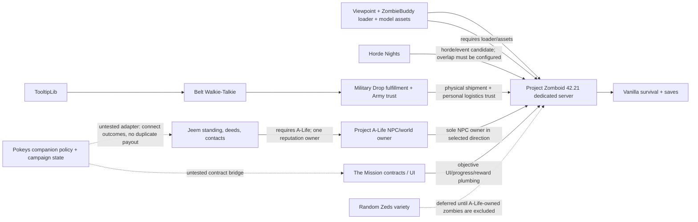
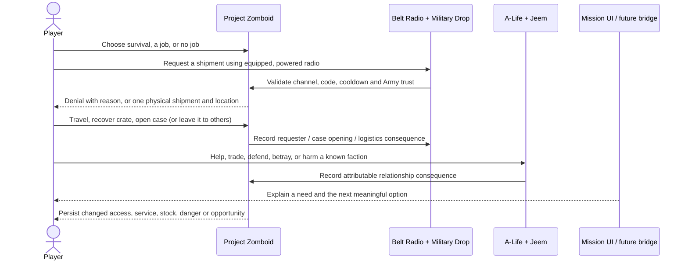
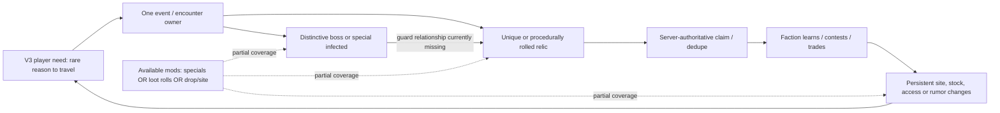
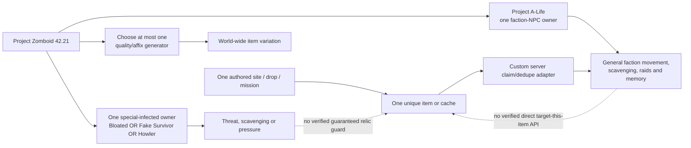

# Pokeys 100 Days Gone — V2 implementation and V3 mod-scene report

**Research snapshot:** Project Zomboid Build 42.21.0, revision `4a0e9546ec`; installed payloads and Workshop pages rechecked October 19, 2026. **Audience:** project owner / human review. This report documents the current V2 direction, the actual implementation state, and a separate V3 research lane. A V3 candidate is not an adopted feature or a scope change. Steam currently displays “removed/incompatible” banners on [Military Drop](https://steamcommunity.com/sharedfiles/filedetails/?id=3811752923) and [RarityThreads](https://steamcommunity.com/sharedfiles/filedetails/?id=3775673766). This does not erase prior local-payload test evidence, but it makes future subscription/update availability uncertain; see HR-011.

## Executive read

V1 remains the foundation and is **not accepted**. Its first-person/presentation, survival, faction, horde, recovery and optional-interaction gates remain in the project status record. V2 is the connected living-world expansion: faction needs and jobs, persistent consequences, one contested supply loop, and optional activities whose rewards do not make ordinary survival worse. V3 is provisional depth; this report researches rare loot and memorable guardians without adding them to scope.

The strongest V2 evidence is an ordinary-player Military Drop cycle: Morgan requested a medical shipment by radio, physically recovered and opened its case, received medical supplies, gained delivery trust, was refused a second request during cooldown, and retained inventory through a clean dedicated-server restart. The NPC/reputation direction is Project A-Life + Jeem, replacing Bandits as the one NPC owner in this candidate profile. A separate isolated `faction-contract-trial` now verifies the bridge across A-Life + Jeem + The Mission: the ordinary account completed the custom gather contract, received exactly one 1.5625-point Jeem County EMS standing award, claimed one shared-cooldown medical aid bottle, and saw the reward/standing/cooldown persist after a clean restart. A repeated aid request was refused. This is one tested faction-contract/aid slice, not an accepted all-mod stack, PvP consequence, physical NPC defense, or capacity result.

The existing workshop collection is hidden and contains only the three presentation references; new V2 items are pinned trial candidates and must not be confused with collection members or a release stack. The local settings catalogue contains 1,091 upstream declarations from nine inputs. It is the practical source of truth for exact names, types, defaults, ranges, pages, source files and fingerprints; this report summarizes recommendations rather than duplicating a thousand-row appendix.

## Roadmap and evidence labels

| Stage | Current meaning | Report treatment |
| --- | --- | --- |
| V1.0 | Foundation: reliable multiplayer, presentation/gunplay, minimal factions, horde pressure, recovery, optional calibration | Still in development; V2 work does not waive or pass V1 gates |
| V1.1 | Readable, killable directing leader (SC-001) | Deferred; not required for the V1.0 gate |
| V2.0 | Connected needs/jobs, changing world state, consequential relationships, contested supply, optional incentive | Active direction; tested slices and untested code are labeled separately |
| V3.0 | More event/mission combinations, locations, strategies and possibly richer simulation | Provisional research only here; no feature adoption or implementation |
| V4.0 | Major polish | Provisional ordering; correctness and accessibility remain continuous work |

Evidence terms used below:

- **Runtime observed** means the named local Build 42.21 isolated fixture performed that behavior. It is not broad compatibility or player-capacity acceptance.
- **Source inspected** means the pinned local Workshop payload contains the described code/configuration seam. It does not prove an engine path works.
- **Author states** means the Workshop author documents the claim. It can guide a trial but is not our compatibility result.
- **Inference / review** means a design implication or a human choice, not a verified behavior.

## System map

### Current foundation and V2 candidate owners

Solid lines indicate an existing dependency/owner relationship or tested server interaction; dotted lines are untested integration targets. The rendered evidence base is not one accepted all-mod stack: tests used isolated worlds to keep NPC, horde, supply and presentation ownership from colliding. Military Drop's case trust is separate from Jeem reputation. Do not add another drop owner or NPC owner to the same world.

### Intended V2 player loop

The final two lines are the V2 product goal; the full loop is not yet implemented. A Mission objective must not pay a second reward for an outcome already paid by Jeem or Military Drop.

## Inventory: what is active, retained, or only a candidate

“In inventory” below means subscribed/pinned locally. The hidden collection currently has three verified members: ZombieBuddy, Viewpoint and PZVoxelStudioViewpoint assets. It is not the whole modpack.

| Mod / Workshop ID | Role and project fit | Compatibility, dependencies, interaction and limits | Practical knobs and recommendation | Evidence |
| --- | --- | --- | --- | --- |
| **ZombieBuddy** / 3619862853 | Java loader for Viewpoint; supports first-person presentation and the realistic-gunplay pillar indirectly. | Required by Viewpoint. Server/client Java loader behavior and dedicated join were observed. Other Java mods/allowlists are a separate approval surface; no blanket permission policy. | No gameplay tuning recommended. Keep only where Viewpoint is enabled; review its required-item Java allowlist against the exact pinned JAR. | Runtime presentation/dedicated/combined join; combat damage remains unaccepted. Payload pinned in `config/modpack.json`. |
| **Viewpoint** / 3809306528 | First-person camera, arms/weapons presentation and gunplay foundation. | Requires ZombieBuddy and the matching model assets. Native Build 42.21 trial rendered and joined dedicated server. Existing shotgun hit-square warnings mean target damage and shared combat are not accepted. Camera/crosshair/aim settings are client/game option surfaces, not rows in the Lua sandbox catalogue; inspect the Viewpoint options in-game for each client. Potential weapon/firearm patches and UI overlays need exact-stack checks. | Retain first-person as the intended presentation. Do not add a second firearm overhaul to mask damage uncertainty. Keep aiming aids/accessibility settings visible to players; test one vanilla firearm per damage path before tuning. | Runtime visual/UI and dedicated join; exact combat gate is a known limitation. Payload hash is in manifest. |
| **PZVoxelStudioViewpoint assets** / 3810302175 | Models/assets consumed by the Viewpoint presentation. | Asset dependency for the tested Viewpoint appearance. Large payload (~451 MB); not a gameplay system. Individual asset completeness is not audited. | No settings. Include only in Viewpoint profiles. | Loaded in GUI trial; all assets / multiplayer appearance not exhaustively verified. |
| **Horde Nights** / 3782615002 | Existing V1 horde/event owner and candidate V2 ambient pressure. Helps consequential travel and timed decisions. | Must remain the one horde birth/routing owner. Its current loaded-event cap does not account for prior/unloaded survivors; last-target departure can allow births while another group remains. Do not overlap its supply-drop path with Military Drop. | Current isolated samples: small four-birth/debug event; supply drops off in the Military trial; no candidate production cap accepted. Tune schedule, warning, direction, horde size/variant, event duration, empty-server behavior and rewards only in explicit server sandbox profile. Keep no-birth or abort policy conservative pending B-004/B-005. Exact declarations are in `V2_SETTINGS.csv`. | Native scheduled/forced event behavior was observed in isolated V1 fixtures; cross-event/global budget and ordinary player contest remain open. |
| **Bandits2** / 3268487204 | Retained V1 NPC comparison/rollback owner. | Not co-enabled with A-Life. One real armed hostile encounter occurred, but repeated server command handler `Expected a table` exception blocks dependable behavior. It is absent from all A-Life profiles and is not the selected direction. | Keep the old isolated profile/save for comparison only. No tuning or new stack integration until B-002 is diagnosed. | Actual encounter plus repeat server error; not accepted for V2. |
| **Project A-Life NPCs** / 3803984183 | Selected V2 NPC/world simulation direction: persistent logical squads/factions with physical shells near players. Supports persistent world identity and faction encounters. | One NPC owner: replace Bandits in a distinct world/profile. Installed folder says 42.20 but `versionMin=42.21`; server/admin source exposes factions, squads, persistence and shell lifecycle. Jeem detects native A-Life generation and stands down on overlapping features. Random Zeds does not recognize the A-Life UID by itself. Viewpoint adapter exists but is untested. | For the present test use no raids, encounters/outposts/support/revenge/warfare, reduced squad budgets (4), residents/raids/traders off in Jeem trial. `PopulateOnStart=1` means **Off**. These are test settings, not release settings or a zero-population guarantee. Tune population/squad/raid/seed/streaming/faction options in server `SandboxVars.lua`; full names/ranges in CSV. | Source inspected; core and A-Life+Jeem native contact/gift/restart observed. NPC movement/appearance changed over restart; combat/handoff/Viewpoint and ordinary attribution remain untested. |
| **Jeem Extension** / 3806944055 | Adds standing, first-hand reputation vs rumor, deeds, NPC opinions and relationship-facing services. Directly supports consequence and persistent faction access. | Requires/loads after Project A-Life. It is not a second NPC owner. Standing has own bounded labels/pools and event integration. Player-death hooks do not prove killer attribution for PvP. No universal anti-PK policy is implied. | Trial enabled standing/one-reputation; resident bases and traders disabled. Core API applies faction-specific gain/loss rates, label thresholds, witness/rumor decay and group sharing. Preserve defaults until ordinary actions and violence attribution are tested. Use settings catalogue and source manifest; do not change saved group-standing schema as a side effect. | One native bandage gift consumed: Jeem standing +3, NPC opinion +17→+19; same UID generation rehydrated after fresh restart, one bandage retained, opinion +27. Deferred +8 is a source-supported timing explanation, not exact persistence acceptance. |
| **TooltipLib** / 3694097672 | UI support dependency for Belt Radio/Military Drop tooltip behavior. | Required through Belt Radio metadata chain. No standalone gameplay. Keep matching server/client payload. | One `EnableMPSync` sandbox switch plus client tooltip detail modifier (`Shift`) in upstream settings; use default unless a concrete tooltip/sync problem appears. | Source/payload inspected and dependency chain confirmed; not separately gameplay-tested. |
| **Belt Walkie-Talkie** / 3817018338 | Receive-only belt radio, battery/noise tradeoffs; supplies Military Drop's radio interaction. | Requires TooltipLib. Radio eligibility/noise/range integrates with Military Drop request validation. Do not assume the receiver sends a request itself. | Six declarations cover battery drain, audible reception, noise radius, received MP bubble, SP belt reception and recharge time. Keep modest defaults; test whether belt convenience adds noise or removes the intended equipped-radio commitment before enabling it as a shortcut. Exact keys and ranges in CSV. | Military trial used the native handheld radio, not the belt radio; source inspected, feature integration not runtime verified. |
| **Military Drop** / 3811752923 | Requested physical supply drops, case contents and Army logistics trust. Supports contested expeditions, radio play and visible consequence. | The exact pinned 0.5.4 payload metadata requires Belt Radio, which requires TooltipLib; current Workshop page also lists Signal Smoke, Belt Radio and TooltipLib as required items and notes a 0.5.1 breaking change. The same page currently shows “removed/incompatible” banners. Keep the locally pinned payload separate from claims of current Workshop availability. It is the only requested-drop owner in its test; disable Horde Nights' overlapping drops. Personal trust is separate from Jeem and vanilla player faction. New drop zombies are not under a proven shared birth budget. | Test fixture: 900 MHz, auth disabled, 40–60 tile range, one case, zero drop zombies; trust starts 25, `RequisitionBudget=25` means 25%, yielding 2 points, not 25. Release planning should raise travel/risk, use code/auth, cooldown and scarcity, and budget births; do not copy fixture conveniences. Sixty-four declarations include frequency, code/auth period, cooldown, placement/range, case lots, trust erosion, zombie counts, smoke/crash/decoy/salvage/Fulton and debug. Read HTML/CSV then change only one owner-controlled variable at a time. | Ordinary radio request → physical crate → medical case opening → three medical items and trust 25→35; second request refused cooldown; fresh-process restart retained inventory. This is a test of the saved pinned local payload, not a claim that new players can currently obtain it from Workshop. No ordinary horde/NPC contest, auth puzzle, third-party recovery, trust audit after restart or capacity tested. |
| **The Mission** / 3640172314 | Contract objective UI, authored objectives, item requirements/consumption and progress/reward ledger; could present faction jobs without building a full quest UI. | No required mod dependency. Author targets 42.20.4, not a blanket 42.21 certification. Source: gather inventory validation and server reward claims; completed history prefers Steam ID then username while active progress lives on character. Walk progress accepts client snapshots; zombie kill hook does not exclude A-Life shells. Native custom definitions can be appended through runtime API. Avoid default grind/reset and never duplicate Jeem/Drop payout. | Isolated contract profiles are gather-only: kill/walk/survive/refill and auto-reset off; custom definitions enabled. Chosen objective is one-shot, consumes two bandages and rewards one Alcohol Wipes. Native builder includes ID/type/title/description/target/required item/consume/sort/repeat/prerequisite/reward. | **Runtime observed on 42.21:** ordinary account completed custom County EMS relay delivery. In `contract-trial`, Done/reward persisted after restart. In `faction-contract-trial` (Project A-Life + Jeem + The Mission + companion), server logged one native history completion then one Jeem delta of 1.5625; relay panel showed Friendly / 1.56 / credit applied. One Disinfectant aid bottle was granted; a second request was refused. Fresh restart retained mission Done, 1.56 standing, applied grant, one bottle and ~47.5 h shared cooldown; aid remained refused with no visible inventory increase. Not a crash-atomicity, multi-client race, PvP or full compatibility acceptance. See [V2-02 tests](V2-02-supply-contracts.md#faction-contract-trial-jeem-credit-aid-and-clean-restart--observed). |
| **Random Zeds** / 3778522347 | Day/night/weather-conditioned zombie variety and stat/speed profiles. Can make travel and event pressure less predictable. | Current candidate for 42.21 (Random Zombies predecessor was retired for B42). No required dependency; optional Synapse adds Java/API surface and is not recommended initially. Its exclusion flag is `RandomZedsExcluded=true`, but no native A-Life detection exists. It hooks zombie creation before A-Life UID assignment, so a late check alone misses the first mutation. | Use built-in native random-speed options first. If trial proceeds, add a narrow original adapter to mark/skip A-Life shell creation and test birth, unload and rehydrate; keep Synapse absent. Tune day/night/weather proportions, per-type weights and exclusions in its server sandbox options (full list in catalogue). | Source/payload inspected; not enabled with A-Life and not runtime accepted. |
| **Pokeys companion** / `Pokeys100DaysGone` (local 0.4.0; development only) | Original project-owned campaign layer: shared favors/contacts, scheduled observer/calibration, horde aftermath/recovery, and an opt-in The Mission→Jeem relief contract/aid bridge. It translates a tested contract into one existing Jeem deed and limited service rather than simulating NPCs or making a second reputation engine. | No external code dependency in its metadata; optional V2 bridge requires The Mission and Jeem/A-Life at runtime, and operates only if server sandbox option is enabled. Build metadata pins 42.21.0. One ordinary account exercised the four-input dedicated path, but client races, PvP attribution, hard-crash atomicity and broad stack acceptance remain untested. | `mods/Pokeys100DaysGone/42/media/sandbox-options.txt`: `PokeysV2.Enabled` defaults **false**; enable only in an isolated contract profile. The one-shot contract, target/radius (8 tiles), two-bandage cost, Alcohol Wipes reward, County EMS ID and 48-world-hour shared aid cooldown are constants in `V2Rules.lua`, not server knobs. Do not tune those constants until reward/policy review and isolated repeat tests. | Project-owned bridge runtime observed on Build 42.21 in `faction-contract-trial`: one 1.5625 Jeem standing credit, one Disinfectant aid and shared cooldown refusal survived clean restart. `tests/lua/v2_server_spec.lua` adds mocked adapter tests for forged client payloads, deferred/unavailable Jeem, duplicate credit, shared aid cooldown and injected partial-effect failures. Mocked reopening is not actual process-restart or hard-crash proof; see HR-010. Source 0.4.0 is development, not a release. |

### V2 feature source state: exact implementation boundary

1. **Military Drop slice — observed.** `docs/V2-02-supply-contracts.md` records the controlled dedicated test, screenshots and missing gates. The world was deliberately quiet to prove normal delivery, not to demonstrate contest.
2. **A-Life/Jeem slice — observed narrowly.** `docs/V2-01-alife-jeem.md` records the visible medic, conversation, consumed gift, standing/opinion and rehydrated UID. It is a native-admin fixture and not ordinary access, hostile consequences, combat, PvP or cross-owner acceptance.
3. **The Mission + Pokeys 0.4 contract slice — observed in isolation.** `contract-trial` staged the companion with The Mission only. Custom definition registration, ordinary gather completion/consumption/reward, and Done status after fresh process restart were visible. The finite admin supply command supplied exactly two bandages for the fixture; they were not earned from survival.
4. **Pokeys 0.4 contract/standing/aid slice — observed in an isolated four-mod profile.** `faction-contract-trial` contained Project A-Life + Jeem + The Mission + companion only (no Bandits, horde, supply drop or presentation). An ordinary account completed `pokeys_medical_relief_01`; The Mission's server history triggered one 1.5625-point `alife_county_ems` deed. The companion panel visibly showed Friendly, 1.56 points, completion and credit applied. One ordinary aid request added one Disinfectant; the next was refused on cooldown. After clean process restart the same account still saw mission Done, 1.56 points and credit applied; the panel showed ~47.5 h remaining and refused a second aid request with no visible inventory increase. Exactly one credit log appeared before restart and none on restart. This verifies the intended IDs/API on this tested setup, but not failure atomicity, broad version compatibility, NPC body ownership, physical camp defense or multiplayer race behavior.

   The server periodically reconciles native mission history rather than accepting client completion RPCs, reserves a replay latch before applying standing, and records incidents rather than retrying ambiguous partial effects. Friendly/allied County EMS can request one Disinfectant at the relay with a 48-hour shared cooldown. The client panel reports only known state; it does not claim physical NPCs defend the relay. This design avoids a new reputation ledger and does not claim anti-PK behavior.

   **Risks before broader V2 acceptance:** reward history and standing update are not one atomic transaction; shared aid interruption must not duplicate; current scanning inspects the first 16 online players rather than a rotating set. Source inspection confirms `alife_county_ems` in the installed A-Life 1.4.5 faction registry and roster; re-verify this identifier against the exact payload on future updates before save migration/release. No two-client claim race, restart during reservation, hard process crash, natural item acquisition, or physical faction-camp defense has passed.

5. **Random Zeds bridge — not written.** Avoid enabling it with Project A-Life until an adapter intercepts shell creation before initial animation/profile mutation and proves that the right physical NPC remains excluded after restart/unload.
6. **Player-kill consequences — not implemented.** Jeem/A-Life has contextual NPC deed/reputation seams, but no accepted, tested end-to-end player killer attribution. There is no anti-PK design; factions may value an event differently. Defer consequence policy migration and PvP tuning until cause, actor, witness knowledge and repeat protection are reliable.
7. **Companion server-adapter regression — mocked boundary passed.** `tests/lua/v2_server_spec.lua` exercises the actual V2 adapter with mocked game/Jeem/The Mission/inventory calls. It refuses forged completion/account/reward requests, defers credit until Jeem exists, prevents duplicate credit after mocked data reopen, enforces one shared aid cooldown across sequential accounts, and latches ambiguous partial standing/recovery or inventory/notification effects rather than replaying. A follow-up asserts the bridge stays inert when `PokeysV2.Enabled=false` and fails closed on malformed saved schema without overwriting it or granting aid. It is not packet-security, simultaneous-client, engine-serialization, clean-process or hard-crash acceptance. HR-010 retains the operator-recovery decision; automatic retries remain unsafe.

## V2 optional minigame and quality-of-life candidates

These are optional candidates, not current mods in the collection. The principle is that skipped vanilla survival remains useful. A minigame may trade time/noise/parts for narrower information or a modest convenience; it must not become a mandatory reflex gate.

| Candidate | What it adds / fit | Version, MP, dependencies and conflict surface | Knobs and practical recommendation | Evidence / decision |
| --- | --- | --- | --- | --- |
| **The Best Lockpicking [B42.21]** / 3745815281 | Pin-tumbler lockpicking, crowbar/bolt-cutter options, lockpicking skill and padlocks on doors/windows/crates; offers a high-stakes optional route into places. | Author page reports v3.13 validated on 42.20.4+, SP/MP support, server-authoritative XP, persistence. No stated required mod. Must not co-enable its listed predecessor ports (original Better Lockpicking, zRe variants, PH port). May overlap Common Sense crowbar or Immersive Hotwire. 42.21 exact-stack not yet tested. | Settings include new/old puzzle mode, XP multiplier, disable crowbar, disable security-door crowbar, disable mod hotwire, submenu merge, bolt-cutter toggle and minimum Strength/Nimble/Lockpicking. Trial with mod hotwire disabled, a skill-book/tutorial path and accessible non-reflex option; keep native entry viable. | Author documentation: [Workshop page](https://steamcommunity.com/sharedfiles/filedetails/?id=3745815281). Good first minigame spike after contract loop. Human review needed for whether lockpicking replaces native hotwire in final rules. |
| **[B42] Project RV Interior** / 3543229299 | Walk/drive into interior spaces for vans/trucks; creates a convincing mobile base and trip-planning convenience. Supports long sessions and expedition identity. | Author claims SP/MP, >200 interiors, battery/electric, rain collection, customization and split-screen. Server requires `PROJECTRVInterior42` and `map_distanciado;Muldraugh, KY`, `DoLuaChecksum=false`, Workshop ID in server config; author says load first and warns against challenge modes. Map/interior ownership, cell changes, save migration, split-group behavior and current exact stack untested. A-Life source compatibility helper mentions RV Interiors and removes nearby zombies during interior transitions; confirm this current mod follows that same seam. The old `RV Interior` 2822286426 is explicitly not updated for B42—do not use it. | No setting-by-setting audited catalogue yet. Start with vanilla vehicles/interiors, no expansion map packs, preserve the existing test world separately; test player entry/exit, passenger synchronization, ownership/container persistence, zombies at door, disconnect/restart and A-Life near/far shell handling. Avoid disabling Lua checksum globally in a production profile until compatibility/security implications are reviewed. | Author claims and setup: [Project RV Interior](https://steamcommunity.com/sharedfiles/filedetails/?id=3543229299). Strong QOL candidate, but map/checksum and A-Life transition interaction deserve a gated isolated test before proposing collection membership. |
| **Neat Lockpicking** / 3783535220 | Existing V2 survey candidate adds lockpick/crowbar/hotwire minigames and requires NeatUI. | Page claims B42 SP/MP, but exact 42.21 dedicated/test state not verified; its modded hotwire replaces native action. Another more recent B42.21 title may supersede it. Do not combine with The Best Lockpicking or any competing lock/hotwire owner. | Optionality is its main unresolved knob: can native hotwire be retained and minigame bypassed? Do not choose until documented. | Earlier survey record only; rank below The Best Lockpicking because its current 42.21 claim/settings are less clear. |
| **RarityThreads — Someone called RPG?** / 3775673766 | Procedurally rolls persistent rarity/affixes/levels/sockets on clothing. Gives players a long loot chase and lets wearable cosmetics become valued finds; can produce combat bonuses through clothing. | Author states Build 42.20 stable+, no required dependency; TooltipLib optional. Author says server-authoritative rolls, kill progression, sockets, transfers and save persistence. Not a boss-only drop system: containers, outfits, starting inventories and crafting may roll; no faction pursuit. Potential interaction with Viewpoint aiming/recoil/range stats and other item-stat mods; performance and exercise/yoga concerns appear in user comments and are unverified. Steam currently displays “removed/incompatible” banners, so subscription/update availability is uncertain. | Sandbox frequency/tier enablement/drawbacks/advanced stat effects; client option menu and outfit-summary key. Even if availability returns, start with low top-tier frequency and disable/limit combat progression; the published page describes strong firearm stat bonuses and permanent socket/level growth. Need loot-economy and Viewpoint shooting regression. | Current page: [RarityThreads](https://steamcommunity.com/sharedfiles/filedetails/?id=3775673766). Strong procedural-loot *design* candidate, not presently a dependable download or boss-specific reward system. V3 research only. |
| **Random Gear Modifiers** / 3761145498 | Procedural rarity modifiers for weapons, magazines, flashlights, bags, clothing and footwear; broader reward variety. | Author describes SP/MP alpha for 42.20.4, not 42.21 acceptance. May overlap Viewpoint firearm modifiers and RarityThreads; a community discussion reports a B42.21 `RGMManager.lua` getItems error, not reproduced here. Dependency list/actual payload not pinned. | Page describes rarity chances scaling 30→70% by day, category multipliers, tinkering/reroll costs and skill/trait access. Avoid stacking with RarityThreads; only consider after native weapon test and source inspection. | [Workshop page](https://steamcommunity.com/sharedfiles/filedetails/?id=3761145498). Lower priority than clothing-only RarityThreads due alpha/current-version and firearm conflict uncertainty. |

## V3 research: distinctive guardians, valuable finds and faction response

The practical gap is not simply “a strong zombie.” It is a connected authority chain: create a unique target; associate its location and loot with a stable event/owner; resolve death/claim once on the server; change a faction's knowledge, stock or relationship; report why the world changed. Surveyed mods cover pieces, but no inspected candidate supplies this whole loop with Project A-Life and Military Drop.

| Candidate | What it could contribute | Compatibility/dependencies/knobs/conflicts | Assessment |
| --- | --- | --- | --- |
| **Special Infected Framework** / 3780939820 + **The Howler** / 3780939914 | B42 special identity/conversion framework; Howler screams to draw nearby zombies and has a distinct telegraph/deafness/frenzy behavior. Could make an announced event dangerous and memorable. | Framework requires an individual special and does nothing alone. The Howler requires framework 1.5.0 in page metadata. Framework describes deterministic conversion across save/stream and a `chance`/`convert`/`update` API. Howler has natural spawn rate, subtle hints, volume/frenzy/deafness-related controls across changelog. Author says MP behavior is architecturally supported but not field-tested; comments include reports of natural spawns despite zero and sound behavior. The current Steam pages display removed/incompatible banners; availability/update continuity are uncertain. It does not provide a faction, unique reward, or loot guard. | Promising **threat mechanic**, not a boss/relic system. Trial would need a currently obtainable/pinned payload, no-loot fixture, dedicated spawn/client replication, spawn-rate-zero check and sound/save/unload test. Do not add to V2 scope. Sources: [framework](https://steamcommunity.com/sharedfiles/filedetails/?id=3780939820), [Howler](https://steamcommunity.com/sharedfiles/filedetails/?id=3780939914). |
| **Dreadnought — Tank Zombie Mod II** / 3415569986 | Large distinctive named tank-like zombie, high health, knockdown, bash, sprint and vehicle collision options. Potential authored guard archetype. | Page says B41/B42 and MP compatible, but exact latest 42.21 dedicated acceptance absent. Known large-model collision and possible conflicts with other zombie behavior/stat mods; older reports mention B42 damage failures. Listed Version 1 is separate; page tells use II. No verified required dependencies. | Sandbox options reported for spawn rate, health, damage min/max, bash/effects, fractures, disarm, sprint distance, knockdown/collision, vehicle damage and admin skin/name display. Set spawn rate zero for initial manual isolated test; test firearm/melee damage, collision, unloaded owner and kill reward before any natural spawn. It has no integrated rare loot/faction tie. | [Author Workshop page](https://steamcommunity.com/sharedfiles/filedetails/?id=3415569986). Looks configurable but collision/damage risk and current-build uncertainty place it behind newer native B42 specials. |
| **Cheols Special Infected Framework / individual specials** (exact IDs in refresh below) | A separate B42.21.x series with a bloater and Fake Survivor. The Fake Survivor is the strongest loot-adjacent guardian concept found: it scavenges real items, retains its individual state and hunts at night. | Do not confuse with Ian's older SIFramework/Howler (3780939820 / 3780939914); these are distinct frameworks with separate mod IDs/APIs. Cheols' Workshop descriptions claim B42.21.x/MP, but the framework page displays removed/incompatible flags. No local payload or multiplayer runtime test. All zombie-body classifiers/Random Zeds/A-Life need a single-owner compatibility test. | Highest research priority only if Workshop availability and framework source are restored/verified. Fake Survivor is a persistent scavenger/threat, not a scripted loot guardian or faction member. See the current refresh below; it supersedes this older exploratory row. |
| **RarityThreads / RGM** (above) | Procedurally generated item variation; RarityThreads has stronger explicit server/persistence claims. | Neither ties the item to a boss/event or faction claimant. RGM has greater Viewpoint weapon-conflict risk. | Use as loot generation only after a human chooses cosmetic vs statistical progression and a max power budget. | V3 candidates; keep out of V2 stack pending decision. |
| **Airdrop B42 (Estavel)** / 3738819163; **ChopperDrop** / 3678109350 | Alternate physical delivery/event systems with configurable categories/timers/loot and reported zombies or request radio. Could serve as authored site/contested container. | Would overlap the selected Military Drop fulfillment owner and cause multiple radio/drop economies. Author descriptions cite build/MP features but no exact-stack/current dedicated test. ChopperDrop has server-side request/loot controls; Estavel page describes daily real-time timing, one active drop and zombie tiers. | Research only as alternatives, not additions. Replacing Military Drop would require a comparative fixture and explicit owner change; do not install beside it. Neither proves factions pursue loot. | Primary pages: [Estavel](https://steamcommunity.com/sharedfiles/filedetails/?id=3738819163), [ChopperDrop](https://steamcommunity.com/sharedfiles/filedetails/?id=3678109350). |
| **Authentic Z** / collection-dependent candidate | Collectible outfit variation on zombies could make rare cosmetic finds and memorable search targets. | Exact current B42 item/dependencies and MP distribution not verified in this pass; may overlap zombie outfit mods and item loot generation. Does not make a unique durable boss or faction claim. | Do not add until exact B42.21 item is pinned and performance/loot ownership tested. | Research lead only; not sufficient evidence for adoption. |
| **Forgotten Farm Bunker** / 3673620977 | Authored destination could make a unique expedition site with handcrafted caches and clues. | Map/tile pack dependencies and new-cell/save implications make it a separate map decision; exact retained-world compatibility and A-Life population seam not tested. Fixed handmade reward is not procedural and no faction pursues it by default. | Prefer an existing safe-to-use cell/site over adding several map dependencies. If selected, create a fresh world, verify tile dependencies and only then author a low-count cache. | Author page: [Forgotten Farm Bunker](https://steamcommunity.com/sharedfiles/filedetails/?id=3673620977). Candidate for authored location, not a boss/loot integration. |

### V3 candidate refresh — 2026-10-19

This refresh is read-only research against the current Steam Workshop pages; it does not add candidates to the manifest, Workshop collection, or a game profile. Page claims are not local compatibility tests. The project is still on Build 42.21.0 / `4a0e9546ec`; V3 remains unapproved and unimplemented.

| Candidate / owner | What it actually contributes | Version, dependencies, multiplayer, knobs and conflicts | Fit and recommendation |
| --- | --- | --- | --- |
| [Special Infected #01 — Bloated](https://steamcommunity.com/sharedfiles/filedetails/?id=3808245444) + [Cheols Special Infected Framework](https://steamcommunity.com/workshop/filedetails/?id=3808244560) | Slow, durable, distinctive infected; on its death it may release ordinary zombies. Its description says it converts an outdoor ordinary zombie in place, so the overall population does not grow, and its UID registry persists through unload/restart. | Author labels it B42.21.x and MP. Framework is required (3808244560; `CheolsSpecialInfectedFramework`); optional Zombie Dismemberment integration is not needed. Sandbox exposes difficulty presets, death-spawn toggle and damaged-release percentage. Normal preset is stated as 3× ordinary health, a regional maximum of 5 within 150 tiles, and up to 10 released zombies; it cannot pass doors. No exact project-stack test. The framework and Bloated pages displayed Steam “removed/incompatible” notices in this research; availability is unverified. Potential conflict with A-Life and other mods that convert/classify zombie bodies. | Best current **boss-like zombie** candidate by author-described gameplay, but it guards no loot and has no relic/faction link. If availability is restored, trial on a fresh isolated profile with A-Life and Random Zeds absent, death-spawn disabled first, then separately test configured death release and server restart. [Source](https://steamcommunity.com/sharedfiles/filedetails/?id=3808245444). |
| [Special Infected #02 — Fake Survivor](https://steamcommunity.com/sharedfiles/filedetails/?id=3810118747) + same Cheols framework | At distance it appears to be a scavenging survivor; by author description it searches containers and collects actual items into a backpack, hides/disappears if approached during the day, then becomes an aggressive fast hunter at night. Its identity and inventory reportedly persist across server restart; killing it permits recovery of what it collected. | Workshop ID 3810118747 / Mod ID `CheolsFakeSurvivor`; requires framework 3808244560. Page says Build 42.21.x / Multiplayer. Exposed options: natural spawning toggle, natural chance, active cap, health multiplier, loot blacklist. No exact defaults or server proof were available from the page extract; Steam currently flags the framework item removed/incompatible, making the dependency a release/adoption gate. It competes for zombie creation/classification and changes ordinary container loot availability; avoid A-Life and Random Zeds in first test. | Best **living-world scavenger/ambush** concept, not literally a boss and not a targeted relic guardian. It could create a believable cause/effect trail (loot disappears, the survivor returns as a threat), but no faction owns it and no item is guaranteed high-tier. Verify page availability, dedicated persistence, simultaneous-client visibility, loot transfer and cleanup before considering it. [Source](https://steamcommunity.com/sharedfiles/filedetails/?id=3810118747). |
| [Special Infected Framework 1.5.0 + The Howler](https://steamcommunity.com/sharedfiles/filedetails/?id=3780939820) / [Howler](https://steamcommunity.com/sharedfiles/filedetails/?id=3780939914) | The older Ian-authored framework converts a configurable share of zombies deterministically and offers a `SIFramework.register(name, { chance, convert, update })` modder seam. The Howler calls nearby zombies onto a player and has a telegraph, frenzy and deafness presentation. | Separate from Cheols' Framework; do not mix them or assume API compatibility. Old page says B42, and the Howler page lists Framework 1.5.0. Author changelog says MP support was added (server-driven behavior/scream/client telegraph) but earlier page text says multiplayer is architecturally supported and not field-tested. No direct faction, loot, or guard behavior. Compatibility with current 42.21 and its visible Workshop availability were not confirmed in this refresh. | A **horde catalyst/telegraphed threat**, not a boss or loot owner. Keep as a lower-priority alternative; do not pair with Bloated/Fake Survivor until body-conversion ownership is understood. Use only if the page and pinned payload are available and a dedicated client test becomes possible. |
| [Project A-Life 1.4.5](https://steamcommunity.com/workshop/filedetails/?id=3803984183) (existing V2 trial owner) | Existing persistent faction NPC owner: roaming and offline squads, raids, outposts, scavenging, NPC inventory/corpses, relationships and broad encounter configuration. Its creator can configure NPC identities, roles, gear, attributes, behavior, loot and factions; NPCs remember provocation and can carry away player items. This can create a *human* rival group or a plausible armed camp around an authored site. | Its current page advertises Build 42.21 and SP/COOP/MP, and the update heading says 1.4.5 on Oct 17, but its “Current version” field still says 1.4.3; our installed/tested local payload is pinned 1.4.5. No required dependency is listed. It advertises 100+ sandbox options including population, encounter and raid rates; Creator exposes faction/NPC behavior, identity, equipment and encounter settings. Its own page says use one NPC mod per save because NPC mods compete for zombie bodies. Page notes COOP stability needs more testing. It does not expose a verified “track this relic” order/API: scavenging and raids are general behaviors. | Strongest existing **faction/world simulation** layer, but only for nearby/general competition. It may contest a place by arriving, looting containers or raiding; do not claim it will target a named relic. Keep it the sole NPC owner and add only an event adapter if a later trial proves a server-safe faction-interest seam. The project has a prior narrow A-Life/Jeem runtime trial, not this relic integration. |
| [Project Exile](https://steamcommunity.com/sharedfiles/filedetails/?id=3790259769) | Random “blessed” equipment from containers, zombie-worn gear and craft output. Favored/Exalted items add extra blessings; supported jewelry can be a literal sought-after trinket. Exalted signatures include utility and combat effects (examples include quieter steps, rear vision, movement speed, critical chance, attack speed and XP). | Author says Build 42-only, SP/MP, mid-save safe; no required dependency surfaced. Sandbox controls global blessing frequency, grade odds, zombie/container/crafting generation, and one-time rolls for pre-existing items. WIP and actively updated. Current comments report a multiplayer clothing-sync exception for an eyewear blessing, a watch disappearing when a second blessed watch is equipped, and uncertain movement effects. Those are user reports, not independently reproduced. It is not boss/faction-aware. | Good **handmade-trinket-like reward vocabulary**, but its whole-world roll system distributes bonuses broadly and may create power creep. Not recommended alongside another affix generator. If reviewed later, first test a no-combat/utility-only policy (if supported) and MP equip/transfer/restart cases; page does not establish an exact toggle for each individual blessing. |
| [Someone called RPG? / RarityThreads](https://steamcommunity.com/sharedfiles/filedetails/?id=3775673766) | Procedural clothing rarity, affixes, 75 kill-earned levels and gem sockets, persisted on the item. Gives prolonged pursuit of gear rather than one fixed relic. | Author says Build 42.20 stable+, SP/MP authoritative, no dependency; TooltipLib optional. Sandbox controls high-tier frequency, available tiers, drawbacks and advanced effects. High power ceiling: Legendary/Mythical + level/socket progression can materially alter combat; weapon affixes include damage, aim, recoil, timing, range and angle. Oct 9 comments report co-op corpse sync sometimes yielded clothing without rarity and very high recoil-delay values could make revolvers fire repeatedly; not independently reproduced. Conflicts conceptually with Loot Quality System/Reforged, Project Exile and other stat/rarity systems. | Procedural long-tail gear, not unique event loot. If used, turn off advanced combat effects/kill progression if the current options permit and start with very low high-tier weight. Inference: exact feature-selective disable controls need inspection; page’s listed sandbox knobs do not prove every affix can be disabled. Avoid with Viewpoint until firing regression passes. |
| [Loot Quality System: Reforged](https://steamcommunity.com/sharedfiles/filedetails/?id=3761032180) | Quality tiers and category-specific affixes across weapons, clothing, ammo, medicine, food, electronics, vehicles, farming, fishing, trapping and resources; supports persistent item qualities through server snapshots and conversion lifecycles. More comprehensive world-wide procedural variation than RarityThreads. | Current page reports v3.0.15 / Build 42.20.x SP/MP (title says 42.20+); required TooltipLib, recommended Unified Carry Weight Framework. Explicitly conflicts with Loot Quality System, Random Gear Modifiers and Zed's Item Tiers; optional CleanUI and Ergonomic UI compatibility modules are mutually exclusive. Knobs include tier weights, per-category modules, effect multipliers, affix blacklists and category switches. Server and all clients must use matching versions and restart together; v3.0.15 includes a storage migration warning. No project-stack test. | Closest general **procedural-loot toolkit**, but it rolls across the economy and does not bind an item to a boss, site or faction. It can make a broad set of finds matter, but is a larger balance/stat surface and overlaps combat presentation. Choose at most one rarity system. Use item/category exclusions and multipliers only after auditing the actual sandbox names and testing Viewpoint. |
| [Zed's Item Tiers](https://steamcommunity.com/sharedfiles/filedetails/?id=3707251461) | Broad Common-to-Legendary item tiering; supports weapons, clothing, containers, books, food and crafting inheritance. | Page says build versions tested 42.13–42.16; MP is explicitly “not tested.” Requires a small library/framework, and ZombieBuddy is optional for its weapon-weight path. Default weights shown are 80/16/3.2/0.64/0.16 percent, respectively. The old item can affect many vanilla and modded stats and the page comments note repair/fill incompatibilities. | Not a fit for our 42.21 MP target until updated and tested; included as a useful **negative comparison**, not an adoption candidate. Do not combine with the other quality systems. |
| [Dreadnought — Tank Zed Mod II](https://steamcommunity.com/sharedfiles/filedetails/?id=3415569986) | Oversized melee boss with damage/health, bash, injury/disarm, sprint and admin-skin controls. | Page advertises B41/B42 and MP but has a large-model collision warning and possible conflicts with zombie behavior/stat mods. A recent page comment says the tested version was B42.1, not B42.2; this is not verified for our 42.21. No proven dependency or loot handoff. | Demote behind current 42.21 specials. The existing page and project have not passed the exact game build; no relic or faction behavior is included. |

#### What the refreshed survey establishes

The strongest practical combination is **not a proven drop-in pack**. It is a set of separable owners:

* **Boss/guardian:** Bloated is the clearest tank-like encounter; Fake Survivor is the most distinctive “show business” scavenger that already creates its own cause/effect; Project A-Life can provide armed human factions and camps. Each is a *different competing world/body owner*. Do not stack them by default. A-Life's page explicitly warns against another NPC mod, and the special-infected frameworks each rewrite/identify zombie entities.
* **Loot:** Project Exile is closest to a trinket-like blessing; RarityThreads is a longer wearable progression; Loot Quality System: Reforged spans the broadest procedural economy. None says “this named guardian owns this specific relic.” Only choose one after reviewing power budgets and actual sandbox names. The project's existing Viewpoint gunplay and faction gun access make random combat upgrades unusually consequential.
* **Faction response:** A-Life can scavenge, raid and remember player hostility; its documented gameplay is not a reliable exact-relic pursuit command. Military Drop can provide a physical cache but is its own V2 owner and does not itself supply faction contest. The Mission can present objectives and completion; the tested project contract path proves a single one-time completion/Jeem credit/aid sequence, not boss death or loot custody.
* **Smallest custom concept if later approved:** a **Relic Site Adapter**, not a new AI or loot engine. Store one stable event/site ID, guardian owner ID, one item template/marker, claim state and last-known site in server GlobalModData. Let exactly one chosen owner create/restore the guardian; on the first authenticated death or recovery, atomically close the event, award one item, and emit one faction deed/rumor. Have the faction receive an abstract “site worth investigating” goal; instantiate physical NPCs only near players through the existing NPC owner. Start with a fixed utility/cosmetic reward, then test restart/duplicate claims, and only later add procedural rolls. Do not spawn a second director or track every entity every frame.
* **Existing seams:** the older Ian SI framework documents `SIFramework.register(name, { chance, convert, update })`, but that is **not** the Cheols framework API and its current 42.21 support is not established. The Cheols series advertises shared registration/identity but its public description does not document a modder function contract. A-Life sets `zombie:getModData().ProjectALifeOwned == true` and asks other mods to skip those bodies. Existing tested project APIs include The Mission custom definitions/completion and the companion's persistent deed/claim ledger. None of these sources demonstrates one crash-atomic guardian death → unique loot → faction pursuit transaction; this must be a small spike before committing to custom architecture.

**Research recommendation:** keep all of this as a V3 option set. If the owner later chooses a deceptive scavenger, verify Workshop availability and its dependency first; if a conventional boss is preferred, trial only Bloated with the release population budget explicitly controlled. For rare loot, prefer a one-off handcrafted cosmetic/utility cache for the first integration proof rather than introducing an always-on RPG economy. No V3 feature, dependency, profile, Workshop membership or code was added by this refresh.

### Additional scene scan — 2026-10-19

Two relevant leads change the candidate comparison, but neither is a ready replacement for the existing recommendation:

| Candidate | Verified claim and controls | Compatibility / boundary | Assessment |
| --- | --- | --- | --- |
| [ApocalipseBR Regiões](https://steamcommunity.com/workshop/filedetails/?id=3706462687), Workshop 3706462687 / `ApocalipseBR_Regioes` | Workshop describes Build 42 (≥42.14), MP-first and SP-compatible area rules, including per-zone zombie behavior, safe/PvP/sprinter/custom zones, a boss-by-outfit registry with guaranteed stats/custom health/theme/sounds, and an API for other mods to register boss modules. Zones are edited by admin map panel or text configuration. Knobs include per-trait 0–100% chances (speed, senses, toughness, strength, memory/cognition), armor / extra-hit `maxHits` (1–99), boss outfit registration, scream timing/chance/volume/range/cooldown, horde-alert radius, anti-spam and debug settings. Recent notes describe nearby-only MP sync for toughness and an on/off switch for automatic safezone/PvP tagging. | No external required mod is listed; it incorporates an enhanced “theySEE YOU” scream system with credit. Author calls it MP-designed and includes a 42.20 server-user report; that is not a dedicated test in our 42.21 stack. Its zones can directly change PVP and zombie rules, so the safe trial should have automatic PvP and safezone behavior disabled and use a disposable profile. A custom boss still needs an outfit/stat/API registration and does not inherently guard loot, own faction identity, reward, or persistence semantics. Because it overlaps zombie stat/scream behavior and uses visual/outfit registration, test it alone before pairing with A-Life, Random Zeds, Viewpoint or special infected. | Newly surfaced **promising boss authoring / encounter-site framework**. It is the best documented seam found so far for placing a distinctive high-stat boss at a human-authored region, but it does not complete the relic loop. Do not add to active profiles until a clean dedicated client join proves boss replication, health/damage, region boundary behavior, restart and no unwanted PvP. Sources: [Workshop description and controls](https://steamcommunity.com/workshop/filedetails/?id=3706462687); [current update/comments](https://steamcommunity.com/workshop/filedetails/?id=3706462687#commentthread). |
| [Nocturnal Reign / Zombie Lord](https://github.com/CosmicQ/pz-nocturnal-reign) | Public GitHub source/readme describes a rare apex zombie (default 0.5%), 10× health, named town-lord progression, escorting/converging hordes, corpse loot/trophies, and configurable day/night mutations, spawn chance, health, horde and presentation. Repo is MIT licensed. | This is a source repository, not a verified Workshop candidate. README says Build 42, tested on 42.19, co-op and dedicated MP; that is author documentation only, behind our 42.21 target. It changes broad zombie behavior (sunlight retreat, night sprinters, senses, fog and hordes), which is a substantial fit/performance/tonal change and has high overlap with every zombie AI mod in the stack. No external dependency was identified in the README. | Useful **proof that a custom implementation is plausible**, not an install recommendation. Its town identity, persistence, announcements, loot and boss coordination are directionally close to V3, but the global day/night overhaul is far beyond the smallest relic feature. Revisit only if the owner deliberately chooses that horror tone and is willing to maintain a custom B42 AI/network layer. Sources: [README/features](https://github.com/CosmicQ/pz-nocturnal-reign), [compatibility/testing statement](https://github.com/CosmicQ/pz-nocturnal-reign#faq). |

**Net result:** ApocalipseBR raises the ceiling for existing-mod boss composition (region + registered boss + authored cache), while leaving the crucial event/reward/faction ownership bridge unsolved. A practical low-code combination would be an existing POI, an isolated boss registration, and a separately owned fixed cache with one claimant rule; without a tested trigger/ownership callback, it is only co-location, not a guaranteed guarded relic. No Workshop/page claim proves these components interoperate. The public Nocturnal Reign repository should not be treated as a subscribable released mod.

### Smallest custom concepts if existing mods leave the gap

No custom code is authorized or created for V3 in this report. If later selected, the smallest useful system is **Relic Contract Adapter**: one server-owned event ID, one bounded spawn/claim state, one unique item marker, one authoritative death/recovery claimant, and one faction-interest callback. It would not simulate every NPC or replace A-Life. Start with one authored target and one fixed reward to test ownership, persistence and contest before adding procedural rolls.

If a tested item generator such as RarityThreads exposes no safe roll hook, a second tiny module could generate a bounded relic from an allowlist of cosmetic/utility templates at event creation, assign stable event and item IDs, and lock claim/reward to server state. Factions could receive only an abstract `interest/site/lastKnownOwner` record and make a simple nearest-route or rumor decision. A physical NPC guard is spawned only through the existing sole owner; an ordinary horde pressure hook may attract existing zombies if supported. Do not add per-frame global entity tracking, another reputation meter, a second drop owner, or a custom NPC AI stack to make the first experiment work.

The likely seams to investigate are A-Life squad/UID lifecycle and faction identity; Jeem standing/deed callbacks; Military Drop's physical case/claim lifecycle (if it remains the sole drop owner); The Mission custom objective/completion API; and an individual special-infected framework's server-authoritative registration. The current source does **not** establish that those APIs can hand off a unique item and faction claim atomically. The smallest spike should prove that seam before any design commitment.

## Knob map and operating recommendations

1. **Server sandbox is authoritative** for most Lua gameplay declarations. Start from the explicit profile files under `config/server/`; do not treat a mod's published default as the effective project value.
2. **The catalogue is the exact index.** Open [V2_SETTINGS.html](V2_SETTINGS.html) for filters or [V2_SETTINGS.csv](V2_SETTINGS.csv) for review/diff. It includes 1,091 declarations across nine upstream inputs, source files, source hashes, type/default/min/max/translation where extractable. Missing fields mean the upstream declaration or parser did not expose them; read the pinned source before changing a value. It does not certify the effective value after Java code, another mod, or client options override it.
3. **Viewpoint/Java settings are not all sandbox options.** Camera, presentation and aiming controls live in client options/preferences; ZombieBuddy has Java approval/loader surfaces. Keep server-required and client-only settings distinct and verify the exact installed version.
4. **Save-affecting systems need isolated profiles.** A-Life entity records, Jeem standing, The Mission history, Military Drop per-character trust and map/interior cells have different identity/persistence rules. Never infer migration or character-death behavior from one system's successful restart.
5. **Recommended current trial configuration:** one NPC owner (A-Life), Bandits absent, no concurrent Horde Nights drop, no drop zombies, small event counts, no Random Zeds until shell exclusion, no auto mission reset, no pay-for-kill/walk loops, ordinary player role, and fresh isolated save. These are test controls, not V2 release balance.
6. **Minigame design:** keep baseline warning/survival useful; reward optional play with information/route convenience or small diminishing resource savings; preserve a non-reflex path and cancellation; do not multiply contract payouts across connected accounts.

## Human-review queue

The full queue is [HUMAN_REVIEW.md](HUMAN_REVIEW.md); current items relevant to this report are:

| ID | Human decision / unresolved adoption gate |
| --- | --- |
| HR-001 / 002 | Contextual violence consequence and character identity; whether Road Reclaimers become the morally gray faction. |
| HR-003 / 005 / 009 | V3 relic power/rarity; guardian tone; whether factions should actively pursue named loot. |
| HR-004 / 006 | RV Interior map/checksum operations; optional lockpicking versus native hotwiring. |
| HR-007 / 008 | Retained Bandits payload drift; visible desktop/client launch needed before more joined-client tests. |
| HR-010 | Manual-only versus narrowly permissioned reconciliation for ambiguous partial bridge effects. |
| HR-011 | Whether to keep locally pinned Military Drop as a development dependency while Steam marks its page removed/incompatible; how to handle availability/update drift without rehosting upstream payloads. |

These do not authorize V3 implementation or block safe V1/V2 source and test work.

## Source and project records

- Roadmap/design: [V2_LIVING_WORLD.md](V2_LIVING_WORLD.md), [scope decisions](SCOPE_CHANGES.md), [status](STATUS.md).
- NPC owner: [V2-01 trial](V2-01-alife-jeem.md).
- Drop and mission seams: [V2-02 trial](V2-02-supply-contracts.md), [module survey](V2_MOD_SURVEY.md).
- Exact dependency pins and collection separation: [`config/modpack.json`](../config/modpack.json), [Workshop record](WORKSHOP.md).
- Selected runtime proof: [ordinary request](evidence/2026-10-19-v2/01-requisition.png), [physical crate](evidence/2026-10-19-v2/02-physical-delivery.png), [medical recovery](evidence/2026-10-19-v2/03-recovered-medical.png), [fresh restart](evidence/2026-10-19-v2/04-retained-inventory.png), and earlier A-Life images under `evidence/2026-10-18-alife/`.
- Contract integration proof: [Jeem credit and aid cooldown](evidence/2026-10-19-faction-contract/01-credit-and-aid-cooldown.png), [same credit and cooldown after fresh restart](evidence/2026-10-19-faction-contract/02-credit-and-aid-after-restart.png).
- Primary mod pages are linked inline in candidate rows. Workshop claims are explicitly marked author claims; exact installed files/hash details stay in the manifest and catalogue.

## Next independent V2 work

1. Test the handoff with two ordinary clients and inspect identity/share behavior; keep Military Drop and other NPC/horde owners out until that slice is understood.
2. Exercise an interrupted reservation, Jeem unavailable, and aid failure path in disposable worlds; distinguish clean restart from process-crash atomicity.
3. Re-check `alife_county_ems` against the exact future A-Life payload and audit character death/account migration before promoting saved standing records.
4. Preserve the completed trial worlds as evidence; bandages were finite admin fixtures, not earned resources. Do not mark the complete V2 or V1 release accepted.
5. Keep the report and human queue updated as settings/candidates change. Do not add researched V3 content to V2 profiles or workshop collection without a later scope decision.
